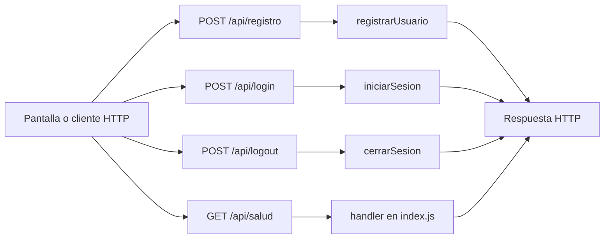

# Gianluca Pizarro · endpoints de registro, sesión y estado del servidor

Edición **75**. Tu responsabilidad principal son los **4 endpoints de la tabla siguiente**. Las funciones auxiliares y las consultas a rutas de otros compañeros se distinguen más abajo. Esto es un reparto para estudiar y defender, no una declaración de quién escribió el código.

## Tus endpoints concretos

| Método y ruta completa | Ruta en el código | Handler real | Acceso |
| --- | --- | --- | --- |
| `POST /api/registro` | [routes/usuarios.routes.js](../routes/usuarios.routes.js#L5) | [registrarUsuario](../controllers/usuarios.controller.js#L51) | Público |
| `POST /api/login` | [routes/usuarios.routes.js](../routes/usuarios.routes.js#L6) | [iniciarSesion](../controllers/usuarios.controller.js#L123) | Público |
| `POST /api/logout` | [routes/usuarios.routes.js](../routes/usuarios.routes.js#L10) | [cerrarSesion](../controllers/usuarios.controller.js#L150) | Sesión requerida |
| `GET /api/salud` | [index.js](../index.js#L16) | [handler de salud](../index.js#L16) | Público |

Las URLs de esta tabla incluyen `/api`. En React vas a ver llamadas como `axios.get("/cuenta")`: [App.jsx](../client/src/App.jsx) configura `axios.defaults.baseURL = "/api"`. No existe una ruta extra por cada función interna.

## Mapa de tus endpoints

En los endpoints privados, `verificarSesion` corre antes del handler. Las tablas y consultas concretas se explican por endpoint; el catálogo usa JSON local y `/ia/estado` lee configuración, no hacen consultas de negocio a MySQL.

## Explicación de cada endpoint

### `POST /api/registro`

**Qué recibe.** Body JSON: `nombre`, `email`, `password`; `apellido` es opcional.

**Qué ejecuta y consulta.** `Usuario.findOne` busca el correo normalizado. Una transacción crea `Usuario`, busca el `Rol` Cliente, crea `UsuarioRol`, crea `Sesion` y registra `Bitacora`.

**Qué valida o decide.** Nombre de 2–100 caracteres; correo con formato y hasta 150; contraseña de al menos 10 caracteres y como máximo 72 bytes UTF-8. Se calcula bcrypt; no se guarda texto plano.

**Respuesta correcta.** `201` → `{user: datosPublicos(usuario)}` y cookie de sesión. El registro ya deja la cuenta conectada.

**Errores propios.** `400` por datos inválidos; `409` por correo existente; `500` si no se puede registrar.

**Quién lo llama.** Acceso.jsx: `enviar`, modo registro; llama `axios.post("/" + modo, datos)`.

**Cómo mostrarlo.** Registrar una cuenta sintética; repetir el correo para mostrar el rechazo sin crear un duplicado.

### `POST /api/login`

**Qué recibe.** Body JSON: `email`, `password`.

**Qué ejecuta y consulta.** Busca `Usuario` activo por correo; compara bcrypt. En una transacción actualiza última conexión, crea `Sesion` y agrega `Bitacora`.

**Qué valida o decide.** No alcanza con que exista el correo: la cuenta debe estar activa y la contraseña coincidir. La respuesta pública no incluye el hash.

**Respuesta correcta.** `200` → `{user: ...}` y cookie de ocho horas.

**Errores propios.** `400` por tipos/longitud inválidos; `401` por credenciales incorrectas; `500` por fallo de operación.

**Quién lo llama.** Acceso.jsx: `enviar`, modo login.

**Cómo mostrarlo.** Ingresar con contraseña incorrecta y después correcta; explicar cómo se genera la sesión.

### `POST /api/logout`

**Qué recibe.** Body JSON: `confirmar: true`; usa la cookie de la sesión actual.

**Qué ejecuta y consulta.** `Sesion.destroy` elimina la fila que coincide con el usuario y el hash de su cookie. Limpia esa cookie del navegador.

**Qué valida o decide.** Requiere sesión válida y confirmación. No elimina la cuenta ni cierra automáticamente todas sus otras sesiones.

**Respuesta correcta.** `204` sin JSON.

**Errores propios.** `400` si no se confirma; `500` si no se puede cerrar. También aplican los errores de sesión comunes.

**Quién lo llama.** App.jsx: `salir`; botón Cerrar sesión y componente Confirmar.

**Cómo mostrarlo.** Cancelar una vez y confirmar después; explicar por qué se vuelve al inicio.

### `GET /api/salud`

**Qué recibe.** No recibe body ni parámetros. Es público.

**Qué ejecuta y consulta.** `sequelize.authenticate()` comprueba la conexión con MySQL; no lista usuarios ni modifica tablas.

**Qué valida o decide.** No es una pantalla de negocio ni comprueba el estado de Cohere.

**Respuesta correcta.** `200` → `{estado: "ok", version: "50" o "75"}`.

**Errores propios.** `503` si no puede conectar a la base.

**Quién lo llama.** Comprobación directa del servidor; ninguna pantalla React lo llama.

**Cómo mostrarlo.** Abrir la URL completa del endpoint y explicar qué significa su respuesta.

## Funciones de apoyo: no son otros endpoints

Conocé para qué sirven cuando aparecen en el recorrido de tus rutas. No se asigna una ruta inexistente ni se cambia el responsable por compartir una función.

| Función auxiliar | Para qué interviene |
| --- | --- |
| [datosPublicos](../controllers/usuarios.controller.js#L14) | Selecciona los campos de la respuesta; no es un endpoint. |
| [abrirSesion](../controllers/usuarios.controller.js#L28) | Crea la sesión y cookie usada por registro/login; no es una ruta separada. |
| [encriptarIrreversible](../controllers/seguridad.controller.js#L4) | Calcula bcrypt de una contraseña. |
| [compararPassword](../controllers/seguridad.controller.js#L5) | Compara una contraseña contra el hash. |
| [hashToken](../controllers/seguridad.controller.js#L7) | Calcula el hash del token de sesión. |

## Archivos que tenés que ubicar

- [controllers/usuarios.controller.js](../controllers/usuarios.controller.js): handlers y lógica de tus endpoints.
- [client/src/pages/Acceso.jsx](../client/src/pages/Acceso.jsx): estado, formulario o carga que llama a esas rutas.
- [client/src/App.jsx](../client/src/App.jsx): estado, formulario o carga que llama a esas rutas.
- [models/index.js](../models/index.js): relaciones; seguí desde ahí solo los modelos usados en tus consultas.
- [auth.controller.js](../controllers/auth.controller.js#L6): antes de un handler privado comprueba cookie, JWT, sesión persistida y cuenta activa; deja el usuario en `req.user`.

## Lo mínimo común para defender estas rutas

Diferenciá `req.params` (id en la URL), `req.query` (filtros después de `?`), `req.body` (JSON enviado) y `req.user` (cuenta autenticada). El usuario propietario se toma de la sesión, no de un id arbitrario enviado por el formulario.

Todos los endpoints privados pueden responder `401` si la sesión falta, vence, se cierra o la cuenta no está habilitada; el middleware puede responder `500` si falla su comprobación. No confundas estos errores compartidos con los que devuelve el handler. El parser general también puede rechazar JSON inválido (`400`) o un body demasiado grande (`413`).

Para respuestas `204`, no hay JSON que leer. Para crear suele usarse `201`; para leer/editar, `200`. En Axios, el JSON está en `respuesta.data`; en DELETE, el body se pasa como `{data: {...}}`.

No hace falta estudiar todo el sistema ni el funcionamiento interno de Vite. Sí poder seguir tu request desde la pantalla hasta las consultas y explicar una respuesta de éxito y una condición de error.

## Librerías que intervienen

Express enlaza rutas con handlers; Sequelize consulta usuarios, roles y sesiones. bcrypt calcula/compara contraseñas; jsonwebtoken firma la sesión, cookie-parser lee la cookie y crypto aporta tokens/hashes. React y Axios envían los formularios; React Router navega después del ingreso.

## Coordinación con otros responsables

- `GET /api/cuenta`: responsable **Simón Castellani**. Entendé qué recibe y devuelve; no se vuelve a asignar como endpoint tuyo.

Consultá el [reparto completo](README.md) y el [alcance](../docs/ALCANCE.md) antes de prometer una ruta de otra entrega.
