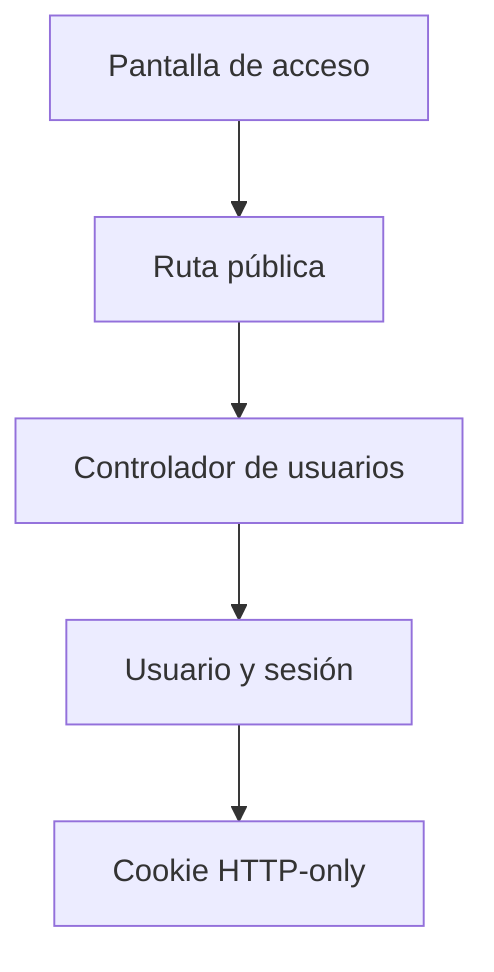

# Gianluca Pizarro · Registro, acceso y recuperación

Esta es tu responsabilidad de estudio y revisión. No declara quién escribió el código.

## Mapa mental

## Archivos y funciones

Pantalla: [client/src/pages/Acceso.jsx](../client/src/pages/Acceso.jsx). Backend: [controllers/usuarios.controller.js](../controllers/usuarios.controller.js). Rutas de cuentas en [usuarios.routes.js](../routes/usuarios.routes.js); las demás en [gimnasio.routes.js](../routes/gimnasio.routes.js).

| Función | Qué hace y qué tenés que poder explicar |
| --- | --- |
| [registrarUsuario](../controllers/usuarios.controller.js#L53) | Valida datos, rechaza correos repetidos, calcula el hash, crea usuario/rol/sesión y devuelve campos públicos. |
| [iniciarSesion](../controllers/usuarios.controller.js#L127) | Busca por correo, compara la contraseña y crea una sesión de ocho horas. |
| [abrirSesion](../controllers/usuarios.controller.js#L30) | Firma un JWT, guarda solo su hash y envía una cookie HTTP-only. |
| [cerrarSesion](../controllers/usuarios.controller.js#L154) | Exige confirmación, elimina la sesión actual y limpia la cookie. |
| [recuperarPassword](../controllers/usuarios.controller.js#L258) | Genera un token aleatorio de media hora y envía o guarda el enlace sin revelar si la cuenta existe. |
| [restablecerPassword](../controllers/usuarios.controller.js#L286) | Consume una sola vez el token, actualiza el hash y revoca las sesiones anteriores. |
| [verificarSesion](../controllers/auth.controller.js#L6) | Verifica firma y vencimiento, sesión persistida y cuenta activa antes de permitir el siguiente controlador. |

## Librerías que intervienen

React y Axios envían formularios; bcrypt calcula/compara hashes; jsonwebtoken firma/verifica sesiones; cookie-parser lee la cookie; Nodemailer envía el enlace cuando hay SMTP. Sequelize consulta usuarios, roles, sesiones y recuperaciones.

## Qué tenés que entender

Cuándo usar registro o login; diferencia entre contraseña, hash, JWT y token de recuperación; por qué la cookie no es legible desde JavaScript; por qué una recuperación invalida las sesiones; qué ocurre cuando no hay SMTP.

En la pantalla ubicá los estados (useState), la carga inicial (useEffect), el submit y las llamadas Axios. Seguí la ruta hasta la función del controlador y el modelo. Entendé qué datos entran, qué se valida, qué consulta se ejecuta y qué respuesta se devuelve. No hace falta memorizar cada palabra, pero sí poder explicar una función y una condición de error.

## Recorrido para defenderlo

Abrí una cuenta sintética, cerrá sesión e ingresá otra vez. Pedí recuperación: explicá dónde está el enlace si no hay SMTP. No muestres tokens ni contraseñas en la exposición.

## Base común mínima

Todos deben poder explicar `pantalla → ruta → controlador → modelo → MySQL`, request/response, async/await y try/catch. Las relaciones están en [models/index.js](../models/index.js). La confirmación visible está en [Confirmar.jsx](../client/src/components/Confirmar.jsx): muestra aceptar/cancelar; el servidor vuelve a exigir confirmación. Consultá [el alcance](../docs/ALCANCE.md) antes de prometer funciones del sistema completo.
