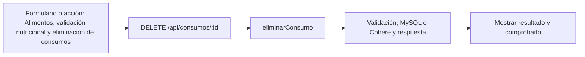

# Gianluca Pizarro · próximo avance

**Tarea nueva:** Alimentos, validación nutricional y eliminación de consumos.

**Estado: pendiente de trabajo y verificación individual.** No es una declaración de que ya lo programaste. Se conserva tu responsabilidad de base del 50 % y se añade un recorrido concreto del incremento.

## Qué tenés que hacer ahora

Validar alimento, unidad, cantidad y metas; seguir la fórmula de nutrientes; implementar/revisar el borrado confirmado de un consumo y comprobar que los totales disminuyen. No agregar rate limiting, correo ni las funciones retiradas.

## Mapa de tu avance

## Tus endpoints y continuidad

| Etapa | Método y ruta | Handler real |
| --- | --- | --- |
| Base del 50 % | `POST /api/registro` | [registrarUsuario](../controllers/usuarios.controller.js#L56) |
| Base del 50 % | `POST /api/login` | [iniciarSesion](../controllers/usuarios.controller.js#L156) |
| Base del 50 % | `POST /api/logout` | [cerrarSesion](../controllers/usuarios.controller.js#L208) |
| Base del 50 % | `GET /api/salud` | [handler de salud](../index.js#L22) |
| Avance nuevo | `DELETE /api/consumos/:id` | [eliminarConsumo](../controllers/nutricion.controller.js#L472) |

## Funciones concretas del avance

| Función | Qué parte recorrés |
| --- | --- |
| [calcularMacros](../controllers/nutricion.controller.js#L4) | Recorre y suma nutrientes; por 100 g/ml o por porción. |
| [datosComida](../controllers/nutricion.controller.js#L79) | Valida nombre/tipo y obtiene los nutrientes de la comida. |
| [actualizarDieta](../controllers/nutricion.controller.js#L146) | Tu tramo compartido es la validación de metas numéricas y calorías enteras; Iván/Paulo guardan la dieta. |
| [eliminarConsumo](../controllers/nutricion.controller.js#L472) | Borra solo el consumo propio confirmado. |

Los helpers son funciones internas, no endpoints adicionales. Si una función sirve a POST y PUT o a generación y adaptación, se revisa entre los dos responsables. No hay que duplicarla ni separarla artificialmente para aparentar más código.

## Entradas, consultas y respuestas de tus rutas

### `POST /api/registro`

**Qué recibe.** Body JSON: `nombre`, `email`, `password`; `apellido` es opcional.

**Qué ejecuta y consulta.** `Usuario.findOne` busca el correo normalizado. Una transacción crea `Usuario`, busca el `Rol` Cliente, crea `UsuarioRol`, crea `Sesion` y registra `Bitacora`.

**Qué valida o decide.** Nombre de 2–100 caracteres; correo con formato y hasta 150; contraseña de al menos 10 caracteres y como máximo 72 bytes UTF-8. Se calcula bcrypt; no se guarda texto plano.

**Respuesta correcta.** `201` → `{user: datosPublicos(usuario)}` y cookie de sesión. El registro ya deja la cuenta conectada.

**Errores propios.** `400` por datos inválidos; `409` por correo existente; `500` si no se puede registrar.

**Quién lo llama.** Acceso.jsx: `enviar`, modo registro; llama `axios.post("/" + modo, datos)`.

**Cómo mostrarlo.** Registrar una cuenta sintética; repetir el correo para mostrar el rechazo sin crear un duplicado.

### `POST /api/login`

**Qué recibe.** Body JSON: `email`, `password`.

**Qué ejecuta y consulta.** Busca `Usuario` activo por correo; compara bcrypt. En una transacción actualiza última conexión, crea `Sesion` y agrega `Bitacora`.

**Qué valida o decide.** No alcanza con que exista el correo: la cuenta debe estar activa y la contraseña coincidir. La respuesta pública no incluye el hash.

**Respuesta correcta.** `200` → `{user: ...}` y cookie de ocho horas.

**Errores propios.** `400` por tipos/longitud inválidos; `401` por credenciales incorrectas; `500` por fallo de operación.

**Quién lo llama.** Acceso.jsx: `enviar`, modo login.

**Cómo mostrarlo.** Ingresar con contraseña incorrecta y después correcta; explicar cómo se genera la sesión.

### `POST /api/logout`

**Qué recibe.** Body JSON: `confirmar: true`; usa la cookie de la sesión actual.

**Qué ejecuta y consulta.** `Sesion.destroy` elimina la fila que coincide con el usuario y el hash de su cookie. Limpia esa cookie del navegador.

**Qué valida o decide.** Requiere sesión válida y confirmación. No elimina la cuenta ni cierra automáticamente todas sus otras sesiones.

**Respuesta correcta.** `204` sin JSON.

**Errores propios.** `400` si no se confirma; `500` si no se puede cerrar. También aplican los errores de sesión comunes.

**Quién lo llama.** App.jsx: `salir`; botón Cerrar sesión y componente Confirmar.

**Cómo mostrarlo.** Cancelar una vez y confirmar después; explicar por qué se vuelve al inicio.

### `GET /api/salud`

**Qué recibe.** No recibe body ni parámetros. Es público.

**Qué ejecuta y consulta.** `sequelize.authenticate()` comprueba la conexión con MySQL; no lista usuarios ni modifica tablas.

**Qué valida o decide.** No es una pantalla de negocio ni comprueba el estado de Cohere.

**Respuesta correcta.** `200` → `{estado: "ok", version: "50" o "75"}`.

**Errores propios.** `503` si no puede conectar a la base.

**Quién lo llama.** Comprobación directa del servidor; ninguna pantalla React lo llama.

**Cómo mostrarlo.** Abrir la URL completa del endpoint y explicar qué significa su respuesta.

### `DELETE /api/consumos/:id`

**Qué recibe.** URL `id`; body `confirmar: true`.

**Qué ejecuta y consulta.** Busca `ComidaConsumida` propia y ejecuta `destroy`.

**Qué valida o decide.** Es borrado de un consumo concreto; a diferencia de la dieta no se marca un estado de baja.

**Respuesta correcta.** `204` sin JSON.

**Errores propios.** `400` sin confirmar; `404` consumo ajeno/inexistente; `500` por fallo.

**Quién lo llama.** Nutricion.jsx modo consumos: `eliminar`; Axios manda el body de DELETE en `data`.

**Cómo mostrarlo.** Eliminar solo un consumo sintético y explicar por qué disminuye el total diario.

## Cuándo está terminado tu bloque

- [ ] Registrar 50 g a 400 kcal/100 g: el servidor calcula 200 kcal.
- [ ] Rechazar cantidades inválidas; no confiar en un total enviado desde React.
- [ ] Cancelar eliminación conserva el consumo; confirmar lo borra y disminuye el total.
- [ ] Explicar el recorrido desde el input hasta la respuesta, sin leer el código palabra por palabra.
- [ ] Registrar qué revisión, cambio o comprobación hiciste realmente; si hay commit, usar la identidad real.

## Tamaño previsto y trabajo compartido

Como referencia, este paquete cubre **11.01 %** de las 1.702 líneas nuevas/reemplazadas del incremento medido. Es cobertura asignada para revisar/trabajar, no un porcentaje de programación ya hecho. No mide dificultad ni tiempo y se reajusta si al trabajar aparece una diferencia de carga.

[Plan y límites del cálculo](../docs/PLAN.md). La meta es cerca de 11 % por persona, con margen; el alcance de entrega puede quedar por encima o por debajo del nombre histórico 75. No se inflan líneas ni se atribuye código intacto como una mejora.

## Lectura del código

Pantalla React → ruta Express → controlador → Sequelize → MySQL. req.params trae el id; req.query, filtros; req.body, JSON; req.user, la cuenta autenticada. Las consultas deben restringir el propietario. Axios envía pedidos desde React y el JSON recibido está en respuesta.data. Un 204 no tiene JSON.

El backend usa for tradicional, if/else, async/await y try/catch. En JSX, map dibuja listas. Las transacciones con commit/rollback evitan guardados parciales; el cifrado, hash y sesión conservan cuentas y datos existentes. La clave de Cohere permanece en el servidor. No se reintroducen los temas retirados ni capas de servicios.

[Criterio del profesor y diferencias conservadas](../docs/CRITERIO-DEL-PROFESOR.md).
