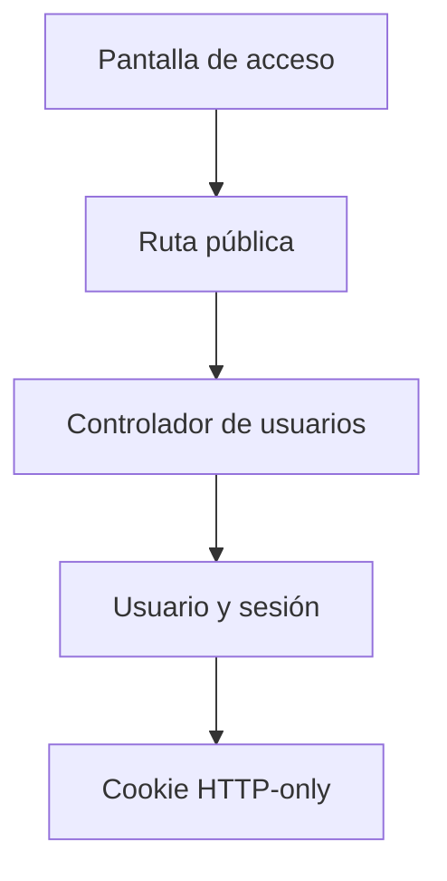

# Gianluca Pizarro · Registro e inicio/cierre de sesión

Responsabilidad de estudio y revisión de la edición 75; no es una declaración de autoría.

## Mapa mental

## Archivos y funciones

Pantalla: [Acceso.jsx](../client/src/pages/Acceso.jsx). Backend: [controllers/usuarios.controller.js](../controllers/usuarios.controller.js). Las rutas están en [usuarios.routes.js](../routes/usuarios.routes.js) y [gimnasio.routes.js](../routes/gimnasio.routes.js).

| Función | Qué hace y qué tenés que poder explicar |
| --- | --- |
| [registrarUsuario](../controllers/usuarios.controller.js#L51) | Valida datos, rechaza correos repetidos, calcula el hash, crea usuario/rol/sesión y devuelve campos públicos. |
| [iniciarSesion](../controllers/usuarios.controller.js#L123) | Busca por correo, compara la contraseña y crea una sesión de ocho horas. |
| [abrirSesion](../controllers/usuarios.controller.js#L28) | Firma un JWT, guarda solo su hash y envía una cookie HTTP-only. |
| [cerrarSesion](../controllers/usuarios.controller.js#L150) | Exige confirmación, elimina la sesión actual y limpia la cookie. |
| [verificarSesion](../controllers/auth.controller.js#L6) | Verifica firma, vencimiento, sesión persistida y cuenta activa antes de llamar al controlador. |

## Librerías

React y Axios envían formularios; bcrypt calcula y compara hashes; jsonwebtoken firma y verifica sesiones; cookie-parser lee la cookie; Sequelize guarda usuarios, roles y sesiones.

## Qué entender

Diferencia entre registro y login, contraseña y hash, JWT y cookie. El servidor comprueba la sesión y cada usuario solo accede a sus datos. No se estudia envío de correos ni cambio de contraseña por enlace.

Ubicá useState, useEffect cuando se use, los eventos del formulario y las llamadas Axios. Para cada función explicá entradas, validación, consulta y respuesta; no hace falta memorizar palabra por palabra.

## Recorrido de defensa

Registrá una cuenta sintética, cerrá sesión, volvé a ingresar y probá una contraseña incorrecta. Explicá qué se guarda en la base y qué vuelve al navegador.

## Base común

Pantalla → ruta → controlador → modelo → MySQL. Las relaciones están en [models/index.js](../models/index.js). La confirmación está en [Confirmar.jsx](../client/src/components/Confirmar.jsx). Consultá el [alcance](../docs/ALCANCE.md). Vite solo inicia o compila React; no es una función del gimnasio ni hay que estudiar sus mecanismos internos.
