# Tomás Menossi · endpoints de chat y rutinas con Cohere

Edición **75**. Tu responsabilidad principal son los **6 endpoints de la tabla siguiente**. Las funciones auxiliares y las consultas a rutas de otros compañeros se distinguen más abajo. Esto es un reparto para estudiar y defender, no una declaración de quién escribió el código.

## Tus endpoints concretos

| Método y ruta completa | Ruta en el código | Handler real | Acceso |
| --- | --- | --- | --- |
| `GET /api/ia/estado` | [routes/gimnasio.routes.js](../routes/gimnasio.routes.js#L36) | [estadoIA](../controllers/ia.controller.js#L452) | Sesión requerida |
| `POST /api/ia/consulta` | [routes/gimnasio.routes.js](../routes/gimnasio.routes.js#L37) | [responderConsulta](../controllers/ia.controller.js#L291) | Sesión requerida |
| `GET /api/ia/conversaciones` | [routes/gimnasio.routes.js](../routes/gimnasio.routes.js#L40) | [listarConversaciones](../controllers/ia.controller.js#L404) | Sesión requerida |
| `GET /api/ia/conversaciones/:id` | [routes/gimnasio.routes.js](../routes/gimnasio.routes.js#L41) | [verConversacion](../controllers/ia.controller.js#L420) | Sesión requerida |
| `POST /api/ia/rutinas` | [routes/gimnasio.routes.js](../routes/gimnasio.routes.js#L38) | [generarRutinaIA](../controllers/ia.controller.js#L88) | Sesión requerida |
| `POST /api/ia/rutinas/:id/adaptar` | [routes/gimnasio.routes.js](../routes/gimnasio.routes.js#L39) | [modificarRutinaIA](../controllers/ia.controller.js#L261) | Sesión requerida |

Las URLs de esta tabla incluyen `/api`. En React vas a ver llamadas como `axios.get("/cuenta")`: [App.jsx](../client/src/App.jsx) configura `axios.defaults.baseURL = "/api"`. No existe una ruta extra por cada función interna.

## Mapa de tus endpoints

```mermaid
flowchart LR
  P["Pantalla o cliente HTTP"]
  P --> E0["GET /api/ia/estado"]
  E0 --> F0["estadoIA"]
  F0 --> R["Respuesta HTTP"]
  P --> E1["POST /api/ia/consulta"]
  E1 --> F1["responderConsulta"]
  F1 --> R["Respuesta HTTP"]
  P --> E2["GET /api/ia/conversaciones"]
  E2 --> F2["listarConversaciones"]
  F2 --> R["Respuesta HTTP"]
  P --> E3["GET /api/ia/conversaciones/:id"]
  E3 --> F3["verConversacion"]
  F3 --> R["Respuesta HTTP"]
  P --> E4["POST /api/ia/rutinas"]
  E4 --> F4["generarRutinaIA"]
  F4 --> R["Respuesta HTTP"]
  P --> E5["POST /api/ia/rutinas/:id/adaptar"]
  E5 --> F5["modificarRutinaIA"]
  F5 --> R["Respuesta HTTP"]
```

En los endpoints privados, `verificarSesion` corre antes del handler. Las tablas y consultas concretas se explican por endpoint; el catálogo usa JSON local y `/ia/estado` lee configuración, no hacen consultas de negocio a MySQL.

## Explicación de cada endpoint

### `GET /api/ia/estado`

**Qué recibe.** Sin body.

**Qué ejecuta y consulta.** Lee la presencia de `COHERE_API_KEY` y el modelo en el entorno. No consulta datos de negocio ni llama a Cohere; la autenticación previa sí accedió a la base.

**Qué valida o decide.** Configurada no significa que haya disponibilidad, saldo o calidad garantizada. Nunca devuelve la clave.

**Respuesta correcta.** `200` → `{configurada: boolean, modelo: string}`.

**Errores propios.** No tiene error propio declarado; aplican los de sesión.

**Quién lo llama.** Asistente.jsx: `cargar`.

**Cómo mostrarlo.** Explicar por qué ver Configurada no equivale a haber recibido una respuesta del proveedor.

### `POST /api/ia/consulta`

**Qué recibe.** Body: `consulta` string, `modo` entrenador/soporte; `conversacion_id` opcional para seguir una conversación del mismo modo.

**Qué ejecuta y consulta.** Si hay conversación, busca `Conversacion` propia y últimos diez `Mensaje`. `responderconsulta` llama `generarConIA` (fetch a Cohere). Tras responder, comprueba otra vez consentimiento y en una transacción guarda conversación si es nueva y dos mensajes.

**Qué valida o decide.** Consentimiento obligatorio; consulta no vacía y hasta 2000 caracteres. El chat solo conversa; no ejecuta acciones. Si falla no guarda el par parcial. La clave está en el backend.

**Respuesta correcta.** `200` → `{conversacion_id, respuesta}`.

**Errores propios.** `400` consulta/modo inválidos; `403` sin consentimiento; `404` conversación ajena/inexistente/de otro modo; `503` error del proveedor, respuesta inválida o fallo al guardar.

**Quién lo llama.** Asistente.jsx: `enviar`; agrega los dos mensajes a la pantalla después del éxito.

**Cómo mostrarlo.** Enviar una pregunta de soporte y un seguimiento; ubicar el id de conversación y explicar qué contexto se vuelve a mandar.

### `GET /api/ia/conversaciones`

**Qué recibe.** Sin body; el endpoint no filtra por modo.

**Qué ejecuta y consulta.** `Conversacion.findAll` propia, ordenada por creación descendente.

**Qué valida o decide.** La pantalla filtra por modo. Listar conversaciones no vuelve a consultar al modelo.

**Respuesta correcta.** `200` → `{items: [...]}`.

**Errores propios.** `500` si no puede listar.

**Quién lo llama.** Asistente.jsx: `cargar`, selector Conversación.

**Cómo mostrarlo.** Cambiar modo y explicar por qué el selector muestra un subconjunto de la respuesta.

### `GET /api/ia/conversaciones/:id`

**Qué recibe.** URL: `id` de la conversación. Sin body.

**Qué ejecuta y consulta.** Busca `Conversacion` por id y usuario; después `Mensaje.findAll` por conversación con orden por fecha/id ascendente.

**Qué valida o decide.** Solo lectura de historial. No se llama a Cohere ni se modifican mensajes al abrir.

**Respuesta correcta.** `200` → `{conversacion, mensajes}`.

**Errores propios.** `404` si no es propia/no existe; `500` si no puede consultar.

**Quién lo llama.** Asistente.jsx: `abrir`; cambia conversación, modo y mensajes visibles.

**Cómo mostrarlo.** Abrir una conversación anterior y mostrar que viene de MySQL, sin generar otra respuesta de IA.

### `POST /api/ia/rutinas`

**Qué recibe.** Body: `preferencias` de 3–1000 caracteres y `confirmar: true`. Para adaptar, además `id` en la URL.

**Qué ejecuta y consulta.** Busca última `MedicionFisica`, `Objetivo` activo y últimos cinco `Entrenamiento` completos. Pide a Cohere un JSON de plan, valida ejercicios y vuelve a comprobar cuenta/consentimiento/objetivo. `guardarRutina` persiste cabecera y detalles en una transacción.

**Qué valida o decide.** Debe haber consentimiento, medidas y objetivo activo. No se guardan ejercicios sin validar. Es una propuesta editable, no una prescripción médica. La llamada externa tiene límite de espera y no se reintenta automáticamente.

**Respuesta correcta.** `201` → `{rutina, message}`.

**Errores propios.** `400` por preferencias/confirmación inválidas; `403` sin consentimiento; `409` si faltan medidas u objetivo; `503` si no se obtiene o guarda una propuesta válida.

**Quién lo llama.** Asistente.jsx: `generar` cuando no hay rutina seleccionada.

**Cómo mostrarlo.** Generar con datos sintéticos, abrir Rutinas y revisar la propuesta; explicar la separación entre este endpoint y el chat.

### `POST /api/ia/rutinas/:id/adaptar`

**Qué recibe.** Body: `preferencias` de 3–1000 caracteres y `confirmar: true`. Para adaptar, además `id` en la URL.

**Qué ejecuta y consulta.** Busca última `MedicionFisica`, `Objetivo` activo y últimos cinco `Entrenamiento` completos. Pide a Cohere un JSON de plan, valida ejercicios y vuelve a comprobar cuenta/consentimiento/objetivo. `guardarRutina` persiste cabecera y detalles en una transacción. Además busca `Rutina` propia activa con sus ejercicios para el contexto anterior. El handler delega en `generarRutinaIA` usando ese id.

**Qué valida o decide.** Conserva el id del plan y reemplaza su contenido; los entrenamientos históricos no se reescriben. Requiere confirmar el envío y reemplazo.

**Respuesta correcta.** `200` → `{rutina, message}` con el mismo id.

**Errores propios.** `400` por entradas inválidas; `403` sin consentimiento; `404` plan ajeno/inexistente/inactivo; `409` si faltan datos; `503` si falla proveedor/validación/guardado.

**Quién lo llama.** Asistente.jsx: `generar` con una rutina elegida para adaptar.

**Cómo mostrarlo.** Adaptar una rutina de prueba y mostrar el mismo id con ejercicios distintos; contrastar con crear otra rutina.

## Funciones de apoyo: no son otros endpoints

Conocé para qué sirven cuando aparecen en el recorrido de tus rutas. No se asigna una ruta inexistente ni se cambia el responsable por compartir una función.

| Función auxiliar | Para qué interviene |
| --- | --- |
| [generarConIA](../controllers/ia.controller.js#L13) | Hace la llamada externa fetch a Cohere, con clave privada y timeout. |
| [responderconsulta](../controllers/ia.controller.js#L264) | Prepara el prompt y valida el texto JSON; distinguirlo de responderConsulta, el handler HTTP. |
| [generarRutina](../controllers/ia.controller.js#L52) | Prepara y valida el JSON del plan. |
| [validarEjercicios](../controllers/rutinas.controller.js#L10) | Validación compartida con el responsable de rutinas. |
| [guardarRutina](../controllers/rutinas.controller.js#L147) | Persistencia compartida con el responsable de rutinas. |

## Archivos que tenés que ubicar

- [controllers/ia.controller.js](../controllers/ia.controller.js): handlers y lógica de tus endpoints.
- [client/src/pages/Asistente.jsx](../client/src/pages/Asistente.jsx): estado, formulario o carga que llama a esas rutas.
- [models/index.js](../models/index.js): relaciones; seguí desde ahí solo los modelos usados en tus consultas.
- [auth.controller.js](../controllers/auth.controller.js#L5): antes de un handler privado comprueba cookie, JWT, sesión persistida y cuenta activa; deja el usuario en `req.user`.

## Lo mínimo común para defender estas rutas

Diferenciá `req.params` (id en la URL), `req.query` (filtros después de `?`), `req.body` (JSON enviado) y `req.user` (cuenta autenticada). El usuario propietario se toma de la sesión, no de un id arbitrario enviado por el formulario.

Todos los endpoints privados pueden responder `401` si la sesión falta, vence, se cierra o la cuenta no está habilitada; el middleware puede responder `500` si falla su comprobación. No confundas estos errores compartidos con los que devuelve el handler. El parser general también puede rechazar JSON inválido (`400`) o un body demasiado grande (`413`).

Para respuestas `204`, no hay JSON que leer. Para crear suele usarse `201`; para leer/editar, `200`. En Axios, el JSON está en `respuesta.data`; en DELETE, el body se pasa como `{data: {...}}`.

No hace falta estudiar todo el sistema ni el funcionamiento interno de Vite. Sí poder seguir tu request desde la pantalla hasta las consultas y explicar una respuesta de éxito y una condición de error.

La clave de Cohere nunca se muestra ni se incluye en ejemplos o capturas. El proveedor puede fallar o equivocarse; no prometas una acción ejecutada desde el chat ni disponibilidad garantizada.

## Librerías que intervienen

Express y Sequelize reciben la consulta y guardan conversaciones. fetch y AbortSignal son de Node.js: llaman a Cohere y limitan la espera, sin un SDK de IA adicional. React y Axios cargan y muestran el chat. No se entrena un modelo en este proyecto.

## Coordinación con otros responsables

- `PUT /api/cuenta`: responsable **Simón Castellani**. Entendé qué recibe y devuelve; no se vuelve a asignar como endpoint tuyo.
- `GET /api/rutinas`: responsable **Joaquín Casanou**. Entendé qué recibe y devuelve; no se vuelve a asignar como endpoint tuyo.

Consultá el [reparto completo](README.md) y el [alcance](../docs/ALCANCE.md) antes de prometer una ruta de otra entrega.

## Cómo leer el código simplificado

El recorrido sigue siendo pantalla React → ruta Express → controlador → modelo Sequelize → MySQL. No hay una capa de servicios. Las decisiones de negocio usan `if`/`else` y los recorridos usan `for (let i = 0; i < lista.length; i++)`. En cada vuelta, `lista[i]` es el elemento de esa posición; el nombre de la lista no tiene significado especial para JavaScript.

Se quitaron `for...of`, `?.`, `??` y `...` del código de controladores y pantallas. Los controladores ya no usan callbacks de `map`, `filter`, `find` o `some` ni comparadores de `sort`: las búsquedas, validaciones y cálculos están desplegados en bucles. En los formularios se construye una copia con los campos explícitos antes de llamar al setter de React; `slice()` copia una lista y `push()` agrega un elemento. No hay que modificar directamente el estado anterior.

En JSX se mantiene `map` únicamente para dibujar listas de elementos. Por ejemplo, `items.map((rutina) => <...>)` produce un bloque visual por rutina; no guarda datos ni llama a MySQL. `key` identifica cada fila para React. Algunas etiquetas usan un condicional sencillo `condicion ? textoSi : textoNo`; la validación del servidor está escrita con `if`. Las funciones de evento con `=>` y la desestructuración también aparecen en los ejemplos del curso: no son otra arquitectura.

No se afirma que todo el proyecto sea idéntico al repaso. El sistema tiene más funciones que un CRUD de ejemplo. Las protecciones conservadas se explican abajo según tu recorrido. [Criterio y diferencias conservadas](../docs/CRITERIO-DEL-PROFESOR.md).

### Tu recorrido, paso a paso

`generarConIA` prepara el pedido HTTP con la clave privada, espera a Cohere y recorre con `for` los bloques de texto de la respuesta. Concatena su contenido y usa `JSON.parse` para convertir el texto JSON en un objeto. Después valida los campos esperados; no ejecuta código recibido del modelo. `AbortSignal.timeout(45000)` limita esa espera a 45 segundos: no es una cadena de reintentos.

`responderconsulta` agrega el mensaje de sistema, recorre el historial y agrega la nueva consulta con `push`. `responderConsulta` lee los últimos diez mensajes, los recorre de atrás hacia adelante para recuperar el orden cronológico y llama al proveedor. Abre una transacción solamente para guardar conversación y los dos mensajes juntos; confirma con `commit` o revierte con `rollback`. El bloqueo del usuario impide guardar una respuesta mientras se retira el consentimiento. La llamada de red queda fuera de ese bloqueo.

En React, `enviar` copia el historial con `slice`, agrega pregunta y respuesta con `push` y actualiza el estado. El selector prepara `conversacionesDelModo` con un bucle. `map` solo dibuja mensajes/opciones. Una respuesta rápida no prueba que sea simulada: el código llama a la API y, si falla, informa el error en lugar de fabricar una contestación.

`generarRutinaIA` prepara con bucles el plan anterior y el resumen de entrenamientos, valida la propuesta con `validarEjercicios` y guarda con `guardarRutina`. `modificarRutinaIA` reutiliza esa operación con el id de la rutina. Los bloqueos y la comprobación del objetivo mantienen coherente el guardado después de esperar al proveedor.
