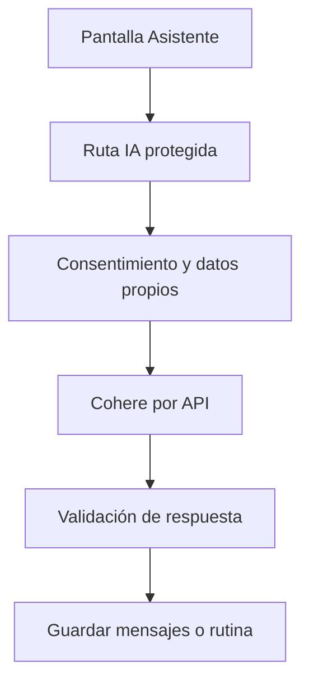

# Tomás Menossi · Asistente IA y rutinas con Cohere

Esta es tu responsabilidad de estudio y revisión. No declara quién escribió el código.

## Mapa mental

## Archivos y funciones

Pantalla: [client/src/pages/Asistente.jsx](../client/src/pages/Asistente.jsx). Backend: [controllers/ia.controller.js](../controllers/ia.controller.js). Rutas de cuentas en [usuarios.routes.js](../routes/usuarios.routes.js); las demás en [gimnasio.routes.js](../routes/gimnasio.routes.js).

| Función | Qué hace y qué tenés que poder explicar |
| --- | --- |
| [estadoIA](../controllers/ia.controller.js#L332) | Informa si hay clave configurada; no asegura que el proveedor esté disponible. |
| [responderConsulta](../controllers/ia.controller.js#L215) | Comprueba consentimiento, modo y propiedad de la conversación; obtiene contexto y guarda los dos mensajes. |
| [responderconsulta](../controllers/ia.controller.js#L195) | Construye la instrucción de entrenador/soporte y valida el texto JSON devuelto por Cohere. |
| [generarConIA](../controllers/ia.controller.js#L14) | Hace una llamada HTTP al proveedor con la clave privada y un límite de 45 segundos; no reintenta. |
| [generarRutina](../controllers/ia.controller.js#L41) | Prepara medidas/objetivo/preferencias, pide el formato del plan y valida sus ejercicios. |
| [generarRutinaIA](../controllers/ia.controller.js#L75) | Reúne datos propios, genera una propuesta y la guarda después de volver a comprobar consentimiento y objetivo. |
| [modificarRutinaIA](../controllers/ia.controller.js#L192) | Usa la misma operación de generación sobre una rutina propia existente; reemplaza el plan, no el historial. |
| [listarConversaciones](../controllers/ia.controller.js#L299) | Lista únicamente las conversaciones del usuario conectado. |
| [verConversacion](../controllers/ia.controller.js#L313) | Comprueba el dueño antes de devolver sus mensajes. |

## Librerías que intervienen

React maneja consulta, modo, conversación y estado de espera. Axios llama al backend. fetch hace la llamada externa; AbortSignal corta la espera; Sequelize conserva planes y mensajes. La clave solo vive en .env del servidor.

## Qué tenés que entender

La IA sí es externa y real, pero no ejecuta acciones desde el chat. Diferenciá chat, generar y adaptar. Entendé system/user/assistant, JSON, historial de diez mensajes, consentimiento, API key, timeout, error 503 y validación antes de guardar. No hay modelo Llama local ni respuestas simuladas de respaldo.

En la pantalla ubicá los estados (useState), la carga inicial (useEffect), el submit y las llamadas Axios. Seguí la ruta hasta la función del controlador y el modelo. Entendé qué datos entran, qué se valida, qué consulta se ejecuta y qué respuesta se devuelve. No hace falta memorizar cada palabra, pero sí poder explicar una función y una condición de error.

## Recorrido para defenderlo

En Mi cuenta activá consentimiento. En Asistente elegí Soporte, preguntá cómo registrar un entrenamiento y hacé un seguimiento. Para una rutina primero cargá medidas y objetivo; generá, revisá en Rutinas y adaptá con nuevas preferencias. Explicá el error visible si falta clave o conexión.

## Base común mínima

Todos deben poder explicar `pantalla → ruta → controlador → modelo → MySQL`, request/response, async/await y try/catch. Las relaciones están en [models/index.js](../models/index.js). La confirmación visible está en [Confirmar.jsx](../client/src/components/Confirmar.jsx): muestra aceptar/cancelar; el servidor vuelve a exigir confirmación. Consultá [el alcance](../docs/ALCANCE.md) antes de prometer funciones del sistema completo.
