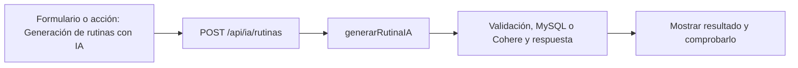

# Tomás Menossi · próximo avance

**Tarea nueva:** Generación de rutinas con IA.

**Estado: pendiente de trabajo y verificación individual.** No es una declaración de que ya lo programaste. Se conserva tu responsabilidad de base del 50 % y se añade un recorrido concreto del incremento.

## Qué tenés que hacer ahora

Recorrer creación de propuesta desde preferencias hasta rutina guardada. Mantener la clave fuera de React, el consentimiento y los errores reales. Revisar formato y transacción con Joaquín; conservar tu chat del 50 %.

## Mapa de tu avance

## Tus endpoints y continuidad

| Etapa | Método y ruta | Handler real |
| --- | --- | --- |
| Base del 50 % | `GET /api/ia/estado` | [estadoIA](../controllers/ia.controller.js#L452) |
| Base del 50 % | `POST /api/ia/consulta` | [responderConsulta](../controllers/ia.controller.js#L291) |
| Base del 50 % | `GET /api/ia/conversaciones` | [listarConversaciones](../controllers/ia.controller.js#L404) |
| Base del 50 % | `GET /api/ia/conversaciones/:id` | [verConversacion](../controllers/ia.controller.js#L420) |
| Avance nuevo | `POST /api/ia/rutinas` | [generarRutinaIA](../controllers/ia.controller.js#L88) |

## Funciones concretas del avance

| Función | Qué parte recorrés |
| --- | --- |
| [generarRutina](../controllers/ia.controller.js#L52) | Formato y validación de la propuesta; compartida con Joaquín. |
| [generarRutinaIA](../controllers/ia.controller.js#L88) | Genera un plan nuevo sin id; contexto y persistencia compartidos con adaptación. |
| [generarConIA](../controllers/ia.controller.js#L13) | Llamada real a Cohere y validación del JSON. |

Los helpers son funciones internas, no endpoints adicionales. Si una función sirve a POST y PUT o a generación y adaptación, se revisa entre los dos responsables. No hay que duplicarla ni separarla artificialmente para aparentar más código.

## Entradas, consultas y respuestas de tus rutas

### `GET /api/ia/estado`

**Qué recibe.** Sin body.

**Qué ejecuta y consulta.** Lee la presencia de `COHERE_API_KEY` y el modelo en el entorno. No consulta datos de negocio ni llama a Cohere; la autenticación previa sí accedió a la base.

**Qué valida o decide.** Configurada no significa que haya disponibilidad, saldo o calidad garantizada. Nunca devuelve la clave.

**Respuesta correcta.** `200` → `{configurada: boolean, modelo: string}`.

**Errores propios.** No tiene error propio declarado; aplican los de sesión.

**Quién lo llama.** Asistente.jsx: `cargar`.

**Cómo mostrarlo.** Explicar por qué ver Configurada no equivale a haber recibido una respuesta del proveedor.

### `POST /api/ia/consulta`

**Qué recibe.** Body: `consulta` string, `modo` entrenador/soporte; `conversacion_id` opcional para seguir una conversación del mismo modo.

**Qué ejecuta y consulta.** Si hay conversación, busca `Conversacion` propia y últimos diez `Mensaje`. `responderconsulta` llama `generarConIA` (fetch a Cohere). Tras responder, comprueba otra vez consentimiento y en una transacción guarda conversación si es nueva y dos mensajes.

**Qué valida o decide.** Consentimiento obligatorio; consulta no vacía y hasta 2000 caracteres. El chat solo conversa; no ejecuta acciones. Si falla no guarda el par parcial. La clave está en el backend.

**Respuesta correcta.** `200` → `{conversacion_id, respuesta}`.

**Errores propios.** `400` consulta/modo inválidos; `403` sin consentimiento; `404` conversación ajena/inexistente/de otro modo; `503` error del proveedor, respuesta inválida o fallo al guardar.

**Quién lo llama.** Asistente.jsx: `enviar`; agrega los dos mensajes a la pantalla después del éxito.

**Cómo mostrarlo.** Enviar una pregunta de soporte y un seguimiento; ubicar el id de conversación y explicar qué contexto se vuelve a mandar.

### `GET /api/ia/conversaciones`

**Qué recibe.** Sin body; el endpoint no filtra por modo.

**Qué ejecuta y consulta.** `Conversacion.findAll` propia, ordenada por creación descendente.

**Qué valida o decide.** La pantalla filtra por modo. Listar conversaciones no vuelve a consultar al modelo.

**Respuesta correcta.** `200` → `{items: [...]}`.

**Errores propios.** `500` si no puede listar.

**Quién lo llama.** Asistente.jsx: `cargar`, selector Conversación.

**Cómo mostrarlo.** Cambiar modo y explicar por qué el selector muestra un subconjunto de la respuesta.

### `GET /api/ia/conversaciones/:id`

**Qué recibe.** URL: `id` de la conversación. Sin body.

**Qué ejecuta y consulta.** Busca `Conversacion` por id y usuario; después `Mensaje.findAll` por conversación con orden por fecha/id ascendente.

**Qué valida o decide.** Solo lectura de historial. No se llama a Cohere ni se modifican mensajes al abrir.

**Respuesta correcta.** `200` → `{conversacion, mensajes}`.

**Errores propios.** `404` si no es propia/no existe; `500` si no puede consultar.

**Quién lo llama.** Asistente.jsx: `abrir`; cambia conversación, modo y mensajes visibles.

**Cómo mostrarlo.** Abrir una conversación anterior y mostrar que viene de MySQL, sin generar otra respuesta de IA.

### `POST /api/ia/rutinas`

**Qué recibe.** Body: `preferencias` de 3–1000 caracteres y `confirmar: true`. Para adaptar, además `id` en la URL.

**Qué ejecuta y consulta.** Busca última `MedicionFisica`, `Objetivo` activo y últimos cinco `Entrenamiento` completos. Pide a Cohere un JSON de plan, valida ejercicios y vuelve a comprobar cuenta/consentimiento/objetivo. `guardarRutina` persiste cabecera y detalles en una transacción.

**Qué valida o decide.** Debe haber consentimiento, medidas y objetivo activo. No se guardan ejercicios sin validar. Es una propuesta editable, no una prescripción médica. La llamada externa tiene límite de espera y no se reintenta automáticamente.

**Respuesta correcta.** `201` → `{rutina, message}`.

**Errores propios.** `400` por preferencias/confirmación inválidas; `403` sin consentimiento; `409` si faltan medidas u objetivo; `503` si no se obtiene o guarda una propuesta válida.

**Quién lo llama.** Asistente.jsx: `generar` cuando no hay rutina seleccionada.

**Cómo mostrarlo.** Generar con datos sintéticos, abrir Rutinas y revisar la propuesta; explicar la separación entre este endpoint y el chat.

## Cuándo está terminado tu bloque

- [ ] Sin consentimiento no se envía contexto.
- [ ] Una creación válida obtiene un id nuevo y detalles persistidos.
- [ ] Sin proveedor no se fabrica una respuesta ni se guarda una rutina parcial.
- [ ] Explicar el recorrido desde el input hasta la respuesta, sin leer el código palabra por palabra.
- [ ] Registrar qué revisión, cambio o comprobación hiciste realmente; si hay commit, usar la identidad real.

## Tamaño previsto y trabajo compartido

Como referencia, este paquete cubre **9.28 %** de las 1.702 líneas nuevas/reemplazadas del incremento medido. Es cobertura asignada para revisar/trabajar, no un porcentaje de programación ya hecho. No mide dificultad ni tiempo y se reajusta si al trabajar aparece una diferencia de carga.

[Plan y límites del cálculo](../docs/PLAN.md). La meta es cerca de 11 % por persona, con margen; el alcance de entrega puede quedar por encima o por debajo del nombre histórico 75. No se inflan líneas ni se atribuye código intacto como una mejora.

## Lectura del código

Pantalla React → ruta Express → controlador → Sequelize → MySQL. req.params trae el id; req.query, filtros; req.body, JSON; req.user, la cuenta autenticada. Las consultas deben restringir el propietario. Axios envía pedidos desde React y el JSON recibido está en respuesta.data. Un 204 no tiene JSON.

El backend usa for tradicional, if/else, async/await y try/catch. En JSX, map dibuja listas. Las transacciones con commit/rollback evitan guardados parciales; el cifrado, hash y sesión conservan cuentas y datos existentes. La clave de Cohere permanece en el servidor. No se reintroducen los temas retirados ni capas de servicios.

[Criterio del profesor y diferencias conservadas](../docs/CRITERIO-DEL-PROFESOR.md).
