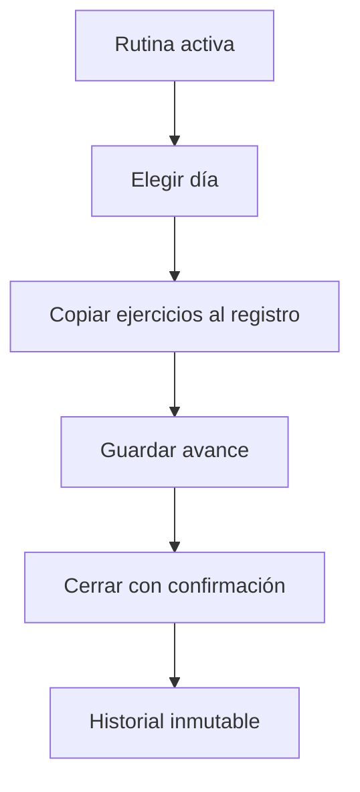

# Iván Lerner · Entrenamientos e historial

Esta es tu responsabilidad de estudio y revisión. No declara quién escribió el código.

## Mapa mental

## Archivos y funciones

Pantalla: [client/src/pages/Entrenamientos.jsx](../client/src/pages/Entrenamientos.jsx). Backend: [controllers/entrenamientos.controller.js](../controllers/entrenamientos.controller.js). Rutas de cuentas en [usuarios.routes.js](../routes/usuarios.routes.js); las demás en [gimnasio.routes.js](../routes/gimnasio.routes.js).

| Función | Qué hace y qué tenés que poder explicar |
| --- | --- |
| [listarEntrenamientos](../controllers/entrenamientos.controller.js#L9) | Devuelve solo el historial propio y sus ejercicios ordenados. |
| [iniciarEntrenamiento](../controllers/entrenamientos.controller.js#L24) | Selecciona una rutina activa y un día con ejercicios; crea una sesión y copia los ejercicios. |
| [actualizarRegistro](../controllers/entrenamientos.controller.js#L93) | Valida el conjunto de ejercicios, guarda el avance o cierra completo/incompleto/cancelado. Un cierre no se puede volver a editar. |

## Librerías que intervienen

React y Axios para formularios; Sequelize para rutina, sesión y ejercicios. Una transacción guarda cabecera y detalle juntos. La columna única usuario_en_curso impide dos sesiones simultáneas.

## Qué tenés que entender

Plan y registro son distintos: editar una rutina no debe cambiar lo entrenado. Completo requiere todos los ejercicios, incompleto al menos uno, cancelado ninguno obligatorio. El peso registrado es el real. Distancia se expresa en km.

En la pantalla ubicá los estados (useState), la carga inicial (useEffect), el submit y las llamadas Axios. Seguí la ruta hasta la función del controlador y el modelo. Entendé qué datos entran, qué se valida, qué consulta se ejecuta y qué respuesta se devuelve. No hace falta memorizar cada palabra, pero sí poder explicar una función y una condición de error.

## Recorrido para defenderlo

Creá una rutina con un ejercicio, iniciá el lunes, registrá peso y marcá realizado. Probá guardar avance antes de completar. Mostrá el historial y explicá por qué el registro conserva una copia.

## Base común mínima

Todos deben poder explicar `pantalla → ruta → controlador → modelo → MySQL`, request/response, async/await y try/catch. Las relaciones están en [models/index.js](../models/index.js). La confirmación visible está en [Confirmar.jsx](../client/src/components/Confirmar.jsx): muestra aceptar/cancelar; el servidor vuelve a exigir confirmación. Consultá [el alcance](../docs/ALCANCE.md) antes de prometer funciones del sistema completo.
