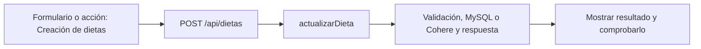

# Iván Lerner · próximo avance

**Tarea nueva:** Creación de dietas.

**Estado: pendiente de trabajo y verificación individual.** No es una declaración de que ya lo programaste. Se conserva tu responsabilidad de base del 50 % y se añade un recorrido concreto del incremento.

## Qué tenés que hacer ahora

Recorrer el formulario de plan nuevo, su POST, el objetivo propio y el guardado de cabecera y comidas. Coordinar los campos del plan con Paulo y el editor de comidas con Valentín.

## Mapa de tu avance

## Tus endpoints y continuidad

| Etapa | Método y ruta | Handler real |
| --- | --- | --- |
| Base del 50 % | `GET /api/entrenamientos` | [listarEntrenamientos](../controllers/entrenamientos.controller.js#L8) |
| Base del 50 % | `POST /api/entrenamientos` | [iniciarEntrenamiento](../controllers/entrenamientos.controller.js#L39) |
| Base del 50 % | `PUT /api/entrenamientos/:id` | [actualizarRegistro](../controllers/entrenamientos.controller.js#L140) |
| Avance nuevo | `POST /api/dietas` | [actualizarDieta](../controllers/nutricion.controller.js#L146) |

## Funciones concretas del avance

| Función | Qué parte recorrés |
| --- | --- |
| [actualizarDieta](../controllers/nutricion.controller.js#L146) | Tu rama principal es crear sin req.params.id. Las validaciones generales y la transacción se revisan con Paulo. |
| [guardar](../client/src/pages/Nutricion.jsx#L130) | Tu recorrido termina en POST /dietas sin editando; no incluye consumos. |

Los helpers son funciones internas, no endpoints adicionales. Si una función sirve a POST y PUT o a generación y adaptación, se revisa entre los dos responsables. No hay que duplicarla ni separarla artificialmente para aparentar más código.

## Entradas, consultas y respuestas de tus rutas

### `GET /api/entrenamientos`

**Qué recibe.** Sin body ni filtros por fecha en el endpoint actual.

**Qué ejecuta y consulta.** `Entrenamiento.findAll` propio con `include` de `EntrenamientoEjercicio`, con `order` que pide a MySQL inicio descendente y posición ascendente de los detalles. No usa `for...of` ni `sort((a,b) => ...)` para reordenarlos después.

**Qué valida o decide.** Devuelve también el iniciado. El frontend separa la sesión en curso del historial cerrado.

**Respuesta correcta.** `200` → `{items: [...]}` con los ejercicios registrados.

**Errores propios.** `500` si no puede consultar.

**Quién lo llama.** Entrenamientos.jsx: `cargar`.

**Cómo mostrarlo.** Mostrar dónde está Tu historial y distinguir una sesión iniciada de una ya cerrada.

### `POST /api/entrenamientos`

**Qué recibe.** Body: `rutina_id` y `dia_semana` entero 1–7.

**Qué ejecuta y consulta.** Busca `Rutina` propia activa, sus `RutinaEjercicio` del día y otra sesión abierta. En una transacción crea `Entrenamiento` y copias `EntrenamientoEjercicio`.

**Qué valida o decide.** Debe haber ejercicios para ese día. Un usuario tiene como máximo una sesión iniciada; `usuario_en_curso` único refuerza esa regla. Fecha del día según zona de la cuenta.

**Respuesta correcta.** `201` → cabecera de la sesión; la pantalla vuelve a listar para obtener los detalles.

**Errores propios.** `400` por datos o día sin ejercicios; `404` por rutina ajena/inexistente/inactiva; `409` por sesión ya abierta; `500` si falla.

**Quién lo llama.** Entrenamientos.jsx: `iniciar`; antes consulta las rutinas con un endpoint de otro responsable.

**Cómo mostrarlo.** Elegir rutina y lunes; iniciar y explicar por qué se copian ejercicios en lugar de leer siempre el plan original.

### `PUT /api/entrenamientos/:id`

**Qué recibe.** URL `id`; body: `estado`, todos los `ejercicios`, `observaciones` string, `distancia_km` numérico; `confirmar: true` si cierra. Cada ejercicio lleva `id`, `realizado` booleano, `series`, `repeticiones`, `peso_utilizado_kg`.

**Qué ejecuta y consulta.** Busca la sesión propia y sus detalles. En una transacción vuelve a leer/bloquear la sesión, actualiza `EntrenamientoEjercicio` y después cabecera, fin y `usuario_en_curso`.

**Qué valida o decide.** Estado iniciado/completado/incompleto/cancelado. Deben venir exactamente los ids propios, sin repetidos. Completo requiere todos realizados; incompleto al menos uno. Cerrado no admite otra edición.

**Respuesta correcta.** `200` → `{message: "Entrenamiento guardado."}`; no devuelve la sesión completa.

**Errores propios.** `400` por registro inválido o falta de confirmar; `404` por sesión ajena/inexistente; `409` por cierre previo/concurrente; `500` por fallo.

**Quién lo llama.** Entrenamientos.jsx: `guardar(estado)`; cambiar entradas solo modifica estado local hasta guardar.

**Cómo mostrarlo.** Guardar avance, marcar realizado y cerrar completo con confirmación; explicar por qué después ya no se edita.

### `POST /api/dietas`

**Qué recibe.** Body: `nombre`, `descripcion` string, `calorias_objetivo`, `proteinas_objetivo_g`, `carbohidratos_objetivo_g`, `grasas_objetivo_g`, `comidas` (1–15); `objetivo_id` opcional. Cada comida: `nombre_comida`, `tipo_comida`, `hora` HH:mm, `alimentos` (1–30). Cada alimento: `nombre`, `cantidad`, `unidad` g/ml/porcion, `calorias`, `proteinas_g`, `carbohidratos_g`, `grasas_g` por 100 g/ml o una porción.

**Qué ejecuta y consulta.** Consulta el objetivo si corresponde. En una transacción crea `Dieta` tipo manual e inserta `DietaComida` mediante `actualizarComida`. Los alimentos se conservan como JSON dentro de cada comida.

**Qué valida o decide.** Metas numéricas 0–9000 (kcal enteras); nombres, tipos de comida y horarios válidos. `calcularMacros` recalcula desde alimentos y cantidades. Un objetivo nuevo asociado debe ser propio y activo.

**Respuesta correcta.** `201` → cabecera creada; la interfaz recarga GET /api/dietas para detalles.

**Errores propios.** `400` por entradas, alimentos, horario u objetivo inválidos; `500` si no puede guardar.

**Quién lo llama.** Nutricion.jsx modo dietas: `guardar` sin id editando.

**Cómo mostrarlo.** Crear un plan con desayuno y un alimento; mostrar que no suma automáticamente al consumo del día.

## Cuándo está terminado tu bloque

- [ ] Crear dieta con al menos dos comidas y comprobar detalles.
- [ ] Rechazar objetivo ajeno y calorías objetivo no enteras.
- [ ] Un fallo en un detalle revierte toda la creación.
- [ ] Explicar el recorrido desde el input hasta la respuesta, sin leer el código palabra por palabra.
- [ ] Registrar qué revisión, cambio o comprobación hiciste realmente; si hay commit, usar la identidad real.

## Tamaño previsto y trabajo compartido

Como referencia, este paquete cubre **11.90 %** de las 1.702 líneas nuevas/reemplazadas del incremento medido. Es cobertura asignada para revisar/trabajar, no un porcentaje de programación ya hecho. No mide dificultad ni tiempo y se reajusta si al trabajar aparece una diferencia de carga.

[Plan y límites del cálculo](../docs/PLAN.md). La meta es cerca de 11 % por persona, con margen; el alcance de entrega puede quedar por encima o por debajo del nombre histórico 75. No se inflan líneas ni se atribuye código intacto como una mejora.

## Lectura del código

Pantalla React → ruta Express → controlador → Sequelize → MySQL. req.params trae el id; req.query, filtros; req.body, JSON; req.user, la cuenta autenticada. Las consultas deben restringir el propietario. Axios envía pedidos desde React y el JSON recibido está en respuesta.data. Un 204 no tiene JSON.

El backend usa for tradicional, if/else, async/await y try/catch. En JSX, map dibuja listas. Las transacciones con commit/rollback evitan guardados parciales; el cifrado, hash y sesión conservan cuentas y datos existentes. La clave de Cohere permanece en el servidor. No se reintroducen los temas retirados ni capas de servicios.

[Criterio del profesor y diferencias conservadas](../docs/CRITERIO-DEL-PROFESOR.md).
