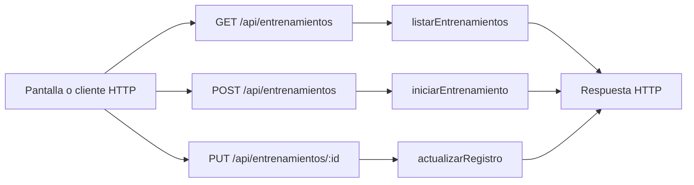

# Iván Lerner · endpoints de entrenamientos e historial

Edición **75**. Tu responsabilidad principal son los **3 endpoints de la tabla siguiente**. Las funciones auxiliares y las consultas a rutas de otros compañeros se distinguen más abajo. Esto es un reparto para estudiar y defender, no una declaración de quién escribió el código.

## Tus endpoints concretos

| Método y ruta completa | Ruta en el código | Handler real | Acceso |
| --- | --- | --- | --- |
| `GET /api/entrenamientos` | [routes/gimnasio.routes.js](../routes/gimnasio.routes.js#L24) | [listarEntrenamientos](../controllers/entrenamientos.controller.js#L8) | Sesión requerida |
| `POST /api/entrenamientos` | [routes/gimnasio.routes.js](../routes/gimnasio.routes.js#L25) | [iniciarEntrenamiento](../controllers/entrenamientos.controller.js#L39) | Sesión requerida |
| `PUT /api/entrenamientos/:id` | [routes/gimnasio.routes.js](../routes/gimnasio.routes.js#L26) | [actualizarRegistro](../controllers/entrenamientos.controller.js#L140) | Sesión requerida |

Las URLs de esta tabla incluyen `/api`. En React vas a ver llamadas como `axios.get("/cuenta")`: [App.jsx](../client/src/App.jsx) configura `axios.defaults.baseURL = "/api"`. No existe una ruta extra por cada función interna.

## Mapa de tus endpoints

En los endpoints privados, `verificarSesion` corre antes del handler. Las tablas y consultas concretas se explican por endpoint; el catálogo usa JSON local y `/ia/estado` lee configuración, no hacen consultas de negocio a MySQL.

## Explicación de cada endpoint

### `GET /api/entrenamientos`

**Qué recibe.** Sin body ni filtros por fecha en el endpoint actual.

**Qué ejecuta y consulta.** `Entrenamiento.findAll` propio con `include` de `EntrenamientoEjercicio`, con `order` que pide a MySQL inicio descendente y posición ascendente de los detalles. No usa `for...of` ni `sort((a,b) => ...)` para reordenarlos después.

**Qué valida o decide.** Devuelve también el iniciado. El frontend separa la sesión en curso del historial cerrado.

**Respuesta correcta.** `200` → `{items: [...]}` con los ejercicios registrados.

**Errores propios.** `500` si no puede consultar.

**Quién lo llama.** Entrenamientos.jsx: `cargar`.

**Cómo mostrarlo.** Mostrar dónde está Tu historial y distinguir una sesión iniciada de una ya cerrada.

### `POST /api/entrenamientos`

**Qué recibe.** Body: `rutina_id` y `dia_semana` entero 1–7.

**Qué ejecuta y consulta.** Busca `Rutina` propia activa, sus `RutinaEjercicio` del día y otra sesión abierta. En una transacción crea `Entrenamiento` y copias `EntrenamientoEjercicio`.

**Qué valida o decide.** Debe haber ejercicios para ese día. Un usuario tiene como máximo una sesión iniciada; `usuario_en_curso` único refuerza esa regla. Fecha del día según zona de la cuenta.

**Respuesta correcta.** `201` → cabecera de la sesión; la pantalla vuelve a listar para obtener los detalles.

**Errores propios.** `400` por datos o día sin ejercicios; `404` por rutina ajena/inexistente/inactiva; `409` por sesión ya abierta; `500` si falla.

**Quién lo llama.** Entrenamientos.jsx: `iniciar`; antes consulta las rutinas con un endpoint de otro responsable.

**Cómo mostrarlo.** Elegir rutina y lunes; iniciar y explicar por qué se copian ejercicios en lugar de leer siempre el plan original.

### `PUT /api/entrenamientos/:id`

**Qué recibe.** URL `id`; body: `estado`, todos los `ejercicios`, `observaciones` string, `distancia_km` numérico; `confirmar: true` si cierra. Cada ejercicio lleva `id`, `realizado` booleano, `series`, `repeticiones`, `peso_utilizado_kg`.

**Qué ejecuta y consulta.** Busca la sesión propia y sus detalles. En una transacción vuelve a leer/bloquear la sesión, actualiza `EntrenamientoEjercicio` y después cabecera, fin y `usuario_en_curso`.

**Qué valida o decide.** Estado iniciado/completado/incompleto/cancelado. Deben venir exactamente los ids propios, sin repetidos. Completo requiere todos realizados; incompleto al menos uno. Cerrado no admite otra edición.

**Respuesta correcta.** `200` → `{message: "Entrenamiento guardado."}`; no devuelve la sesión completa.

**Errores propios.** `400` por registro inválido o falta de confirmar; `404` por sesión ajena/inexistente; `409` por cierre previo/concurrente; `500` por fallo.

**Quién lo llama.** Entrenamientos.jsx: `guardar(estado)`; cambiar entradas solo modifica estado local hasta guardar.

**Cómo mostrarlo.** Guardar avance, marcar realizado y cerrar completo con confirmación; explicar por qué después ya no se edita.

## Funciones de apoyo: no son otros endpoints

Conocé para qué sirven cuando aparecen en el recorrido de tus rutas. No se asigna una ruta inexistente ni se cambia el responsable por compartir una función.

| Función auxiliar | Para qué interviene |
| --- | --- |
| Lógica dentro de los handlers | No tiene una función auxiliar local adicional asignada. Consultá las relaciones de modelos y las funciones React del recorrido. |

## Archivos que tenés que ubicar

- [controllers/entrenamientos.controller.js](../controllers/entrenamientos.controller.js): handlers y lógica de tus endpoints.
- [client/src/pages/Entrenamientos.jsx](../client/src/pages/Entrenamientos.jsx): estado, formulario o carga que llama a esas rutas.
- [models/index.js](../models/index.js): relaciones; seguí desde ahí solo los modelos usados en tus consultas.
- [auth.controller.js](../controllers/auth.controller.js#L5): antes de un handler privado comprueba cookie, JWT, sesión persistida y cuenta activa; deja el usuario en `req.user`.

## Lo mínimo común para defender estas rutas

Diferenciá `req.params` (id en la URL), `req.query` (filtros después de `?`), `req.body` (JSON enviado) y `req.user` (cuenta autenticada). El usuario propietario se toma de la sesión, no de un id arbitrario enviado por el formulario.

Todos los endpoints privados pueden responder `401` si la sesión falta, vence, se cierra o la cuenta no está habilitada; el middleware puede responder `500` si falla su comprobación. No confundas estos errores compartidos con los que devuelve el handler. El parser general también puede rechazar JSON inválido (`400`) o un body demasiado grande (`413`).

Para respuestas `204`, no hay JSON que leer. Para crear suele usarse `201`; para leer/editar, `200`. En Axios, el JSON está en `respuesta.data`; en DELETE, el body se pasa como `{data: {...}}`.

No hace falta estudiar todo el sistema ni el funcionamiento interno de Vite. Sí poder seguir tu request desde la pantalla hasta las consultas y explicar una respuesta de éxito y una condición de error.

## Librerías que intervienen

Express y Sequelize consultan planes y guardan sesión/ejercicios. Las transacciones de Sequelize agrupan la operación; la restricción de la base impide dos sesiones activas. React y Axios manejan el formulario y el historial.

## Coordinación con otros responsables

- `GET /api/rutinas`: responsable **Joaquín Casanou**. Entendé qué recibe y devuelve; no se vuelve a asignar como endpoint tuyo.

Consultá el [reparto completo](README.md) y el [alcance](../docs/ALCANCE.md) antes de prometer una ruta de otra entrega.

## Cómo leer el código simplificado

El recorrido sigue siendo pantalla React → ruta Express → controlador → modelo Sequelize → MySQL. No hay una capa de servicios. Las decisiones de negocio usan `if`/`else` y los recorridos usan `for (let i = 0; i < lista.length; i++)`. En cada vuelta, `lista[i]` es el elemento de esa posición; el nombre de la lista no tiene significado especial para JavaScript.

Se quitaron `for...of`, `?.`, `??` y `...` del código de controladores y pantallas. Los controladores ya no usan callbacks de `map`, `filter`, `find` o `some` ni comparadores de `sort`: las búsquedas, validaciones y cálculos están desplegados en bucles. En los formularios se construye una copia con los campos explícitos antes de llamar al setter de React; `slice()` copia una lista y `push()` agrega un elemento. No hay que modificar directamente el estado anterior.

En JSX se mantiene `map` únicamente para dibujar listas de elementos. Por ejemplo, `items.map((rutina) => <...>)` produce un bloque visual por rutina; no guarda datos ni llama a MySQL. `key` identifica cada fila para React. Algunas etiquetas usan un condicional sencillo `condicion ? textoSi : textoNo`; la validación del servidor está escrita con `if`. Las funciones de evento con `=>` y la desestructuración también aparecen en los ejemplos del curso: no son otra arquitectura.

No se afirma que todo el proyecto sea idéntico al repaso. El sistema tiene más funciones que un CRUD de ejemplo. Las protecciones conservadas se explican abajo según tu recorrido. [Criterio y diferencias conservadas](../docs/CRITERIO-DEL-PROFESOR.md).

### Tu recorrido, paso a paso

`listarEntrenamientos` ya no recorre y ordena en JavaScript. El `order` de Sequelize solicita a MySQL entrenamientos por `fecha_inicio DESC` y sus ejercicios por `orden ASC`. `include` trae los detalles relacionados.

`iniciarEntrenamiento` busca una rutina propia y sus ejercicios del día. Recorre los ejercicios con un `for` tradicional y crea una copia para ese entrenamiento. Todo se guarda junto dentro de una transacción. Cambiar después la rutina no cambia esa copia histórica.

`actualizarRegistro` recorre cada ejercicio recibido; un segundo bucle busca su id entre los originales. Rechaza ids ajenos y repetidos y cuenta `cantidadRealizados`. Completado exige todos; incompleto exige al menos uno. Para guardar, vuelve a comprobar el entrenamiento dentro de la transacción con un bloqueo de fila, actualiza detalles y cabecera y confirma. Si falla, revierte. El bloqueo evita que dos pedidos cierren simultáneamente la misma sesión; no es una capa nueva.

En React, `cargar` busca el iniciado con un bucle y prepara las rutinas activas. `cambiar` copia la lista con `slice`, construye el ejercicio modificado y llama a `setActual` con un objeto nuevo. `entrenamientosAnteriores` separa el historial antes de dibujarlo.
