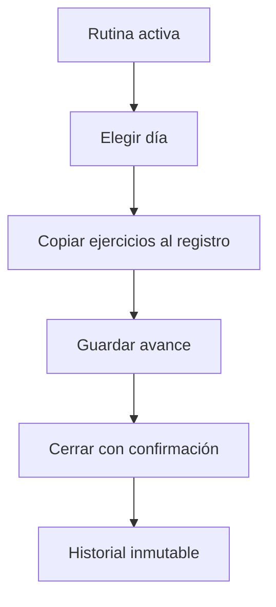

# Iván Lerner · Entrenamientos e historial

Responsabilidad de estudio y revisión de la edición 75; no es una declaración de autoría.

## Mapa mental

## Archivos y funciones

Pantalla: [Entrenamientos.jsx](../client/src/pages/Entrenamientos.jsx). Backend: [controllers/entrenamientos.controller.js](../controllers/entrenamientos.controller.js). Las rutas están en [usuarios.routes.js](../routes/usuarios.routes.js) y [gimnasio.routes.js](../routes/gimnasio.routes.js).

| Función | Qué hace y qué tenés que poder explicar |
| --- | --- |
| [listarEntrenamientos](../controllers/entrenamientos.controller.js#L9) | Devuelve solo el historial propio y sus ejercicios ordenados. |
| [iniciarEntrenamiento](../controllers/entrenamientos.controller.js#L24) | Selecciona una rutina activa y un día con ejercicios; crea una sesión y copia los ejercicios. |
| [actualizarRegistro](../controllers/entrenamientos.controller.js#L93) | Valida el conjunto de ejercicios, guarda el avance o cierra completo/incompleto/cancelado. Un cierre no se puede volver a editar. |

## Librerías

React y Axios para formularios; Sequelize para rutina, sesión y ejercicios. Una transacción guarda cabecera y detalle juntos. La columna única usuario_en_curso impide dos sesiones simultáneas.

## Qué entender

Plan y registro son distintos: editar una rutina no debe cambiar lo entrenado. Completo requiere todos los ejercicios, incompleto al menos uno, cancelado ninguno obligatorio. El peso registrado es el real. Distancia se expresa en km.

Ubicá useState, useEffect cuando se use, los eventos del formulario y las llamadas Axios. Para cada función explicá entradas, validación, consulta y respuesta; no hace falta memorizar palabra por palabra.

## Recorrido de defensa

Creá una rutina con un ejercicio, iniciá el lunes, registrá peso y marcá realizado. Probá guardar avance antes de completar. Mostrá el historial y explicá por qué el registro conserva una copia.

## Base común

Pantalla → ruta → controlador → modelo → MySQL. Las relaciones están en [models/index.js](../models/index.js). La confirmación está en [Confirmar.jsx](../client/src/components/Confirmar.jsx). Consultá el [alcance](../docs/ALCANCE.md). Vite solo inicia o compila React; no es una función del gimnasio ni hay que estudiar sus mecanismos internos.
