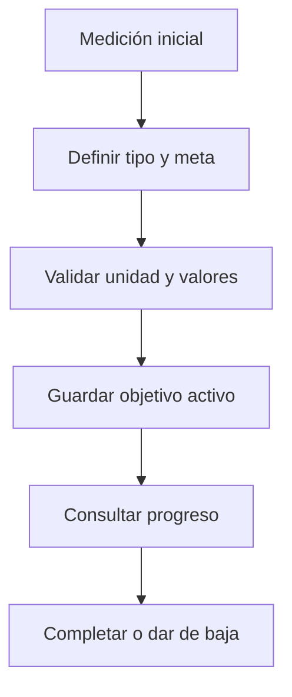

# Paulo López · Objetivos

Esta es tu responsabilidad de estudio y revisión. No declara quién escribió el código.

## Mapa mental

## Archivos y funciones

Pantalla: [client/src/pages/Objetivos.jsx](../client/src/pages/Objetivos.jsx). Backend: [controllers/objetivos.controller.js](../controllers/objetivos.controller.js). Rutas de cuentas en [usuarios.routes.js](../routes/usuarios.routes.js); las demás en [gimnasio.routes.js](../routes/gimnasio.routes.js).

| Función | Qué hace y qué tenés que poder explicar |
| --- | --- |
| [visuaizarObjetivo](../controllers/objetivos.controller.js#L5) | Consulta metas propias que no estén dadas de baja. |
| [definirObjeto](../controllers/objetivos.controller.js#L22) | Valida tipo/unidad/meta y fechas, exige medición inicial y un único objetivo activo; guarda la línea de base. |
| [marcarCompletado](../controllers/objetivos.controller.js#L172) | Requiere confirmación, marca la fecha y libera el lugar para otro objetivo activo. |
| [eliminarObjetivo](../controllers/objetivos.controller.js#L201) | Da de baja la meta sin borrar sus referencias históricas en planes. |

## Librerías que intervienen

React, Axios y Sequelize. La restricción única usuario_activo permite un solo objetivo activo incluso ante dos solicitudes. Intl calcula la fecha según la zona de la cuenta.

## Qué tenés que entender

Peso usa kg, definición usa porcentaje de grasa, resistencia km y frecuencia entrenamientos semanales. Para perder peso la meta debe ser menor; para ganar masa, mayor. El progreso no marca completado automáticamente. Los nombres con grafías particulares vienen del UML.

En la pantalla ubicá los estados (useState), la carga inicial (useEffect), el submit y las llamadas Axios. Seguí la ruta hasta la función del controlador y el modelo. Entendé qué datos entran, qué se valida, qué consulta se ejecuta y qué respuesta se devuelve. No hace falta memorizar cada palabra, pero sí poder explicar una función y una condición de error.

## Recorrido para defenderlo

Cargá una medida. Creá una meta coherente. Mostrá que no permite otra activa. Completala y explicá que se conserva en el historial; cancelá también una confirmación antes de aceptar otra.

## Base común mínima

Todos deben poder explicar `pantalla → ruta → controlador → modelo → MySQL`, request/response, async/await y try/catch. Las relaciones están en [models/index.js](../models/index.js). La confirmación visible está en [Confirmar.jsx](../client/src/components/Confirmar.jsx): muestra aceptar/cancelar; el servidor vuelve a exigir confirmación. Consultá [el alcance](../docs/ALCANCE.md) antes de prometer funciones del sistema completo.
