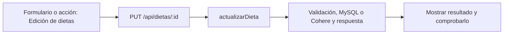

# Paulo López · próximo avance

**Tarea nueva:** Edición de dietas.

**Estado: pendiente de trabajo y verificación individual.** No es una declaración de que ya lo programaste. Se conserva tu responsabilidad de base del 50 % y se añade un recorrido concreto del incremento.

## Qué tenés que hacer ahora

Recuperar un plan existente, modificarlo y guardarlo con PUT sin crear otro id. Revisar con Iván el handler compartido y con Simón la copia de listas. Demostrar que una edición inválida conserva lo anterior.

## Mapa de tu avance

## Tus endpoints y continuidad

| Etapa | Método y ruta | Handler real |
| --- | --- | --- |
| Base del 50 % | `GET /api/objetivos` | [visuaizarObjetivo](../controllers/objetivos.controller.js#L4) |
| Base del 50 % | `POST /api/objetivos` | [definirObjeto](../controllers/objetivos.controller.js#L27) |
| Base del 50 % | `POST /api/objetivos/:id/completar` | [marcarCompletado](../controllers/objetivos.controller.js#L206) |
| Base del 50 % | `DELETE /api/objetivos/:id` | [eliminarObjetivo](../controllers/objetivos.controller.js#L246) |
| Avance nuevo | `PUT /api/dietas/:id` | [actualizarDieta](../controllers/nutricion.controller.js#L146) |

## Funciones concretas del avance

| Función | Qué parte recorrés |
| --- | --- |
| [actualizarDieta](../controllers/nutricion.controller.js#L146) | Tu rama principal busca la dieta propia por id y reemplaza cabecera/detalles dentro de una transacción. |
| [editar](../client/src/pages/Nutricion.jsx#L188) | Tu rama carga una dieta existente. |
| [copiarComidas](../client/src/pages/Nutricion.jsx#L179) | Revisión compartida con Simón de la copia de listas, sin mutar el original. |
| [guardar](../client/src/pages/Nutricion.jsx#L130) | Tu recorrido usa PUT /dietas/:id con editando. |

Los helpers son funciones internas, no endpoints adicionales. Si una función sirve a POST y PUT o a generación y adaptación, se revisa entre los dos responsables. No hay que duplicarla ni separarla artificialmente para aparentar más código.

## Entradas, consultas y respuestas de tus rutas

### `GET /api/objetivos`

**Qué recibe.** Sin body.

**Qué ejecuta y consulta.** `Objetivo.findAll` por usuario, excluye estado eliminado y ordena por fecha de inicio/id descendentes.

**Qué valida o decide.** Se conserva la grafía `visuaizarObjetivo` del UML. Listar no calcula el porcentaje; eso corresponde a `/progreso`.

**Respuesta correcta.** `200` → `{items: [...]}` con objetivos activos y completados.

**Errores propios.** `500` si no puede listar.

**Quién lo llama.** Objetivos.jsx: `cargar`. Rutinas.jsx y, en el 75, Nutricion.jsx también consultan este endpoint para sus selectores.

**Cómo mostrarlo.** Mostrar un objetivo activo y otro completado; explicar qué registros se excluyen.

### `POST /api/objetivos`

**Qué recibe.** Body: `nombre`, `tipo`, `valor_objetivo` numérico, `unidad`, `fecha_inicio`; opcionales `descripcion`, `frecuencia_semanal`, `fecha_fin_estimada`.

**Qué ejecuta y consulta.** Busca la última `MedicionFisica` y un posible `Objetivo` activo. Crea el objetivo con línea de base, medición vinculada y `usuario_activo`; registra `Bitacora`.

**Qué valida o decide.** Un único activo. Tipos: bajar_peso, ganar_masa_muscular, mejorar_resistencia, aumentar_frecuencia_entrenamiento, definir, mantener_peso. kg/%/km/entrenamientos deben corresponder al tipo; fechas válidas y fin no anterior al inicio.

**Respuesta correcta.** `201` → objetivo creado.

**Errores propios.** `400` por datos, unidad o meta incoherentes; `409` por falta de medidas u objetivo activo existente; `500` si falla.

**Quién lo llama.** Objetivos.jsx: `guardar`.

**Cómo mostrarlo.** Crear una meta coherente con la medición y explicar la línea de base y el rechazo de una segunda meta activa.

### `POST /api/objetivos/:id/completar`

**Qué recibe.** URL: `id` del objetivo. Body: `confirmar: true`.

**Qué ejecuta y consulta.** Busca `Objetivo` propio por id y actualiza estado a completado, libera `usuario_activo`, guarda fecha visible y `fecha_cierre` exacta; registra `Bitacora`.

**Qué valida o decide.** Solo admite un objetivo activo. No comprueba que el porcentaje medido haya llegado a 100: completar es una decisión manual.

**Respuesta correcta.** `200` → objetivo actualizado.

**Errores propios.** `400` sin confirmación; `404` si no es propio/no existe; `409` si ya no está activo; `500` si falla.

**Quién lo llama.** Objetivos.jsx: `cambiar(o, true)`.

**Cómo mostrarlo.** Cancelar primero y después completar una meta de prueba; explicar por qué el momento de cierre se conserva.

### `DELETE /api/objetivos/:id`

**Qué recibe.** URL: `id`. Body: `confirmar: true`.

**Qué ejecuta y consulta.** Busca el objetivo propio, cambia estado a eliminado y libera `usuario_activo`; registra `Bitacora`. No destruye la fila ni las referencias históricas de los planes.

**Qué valida o decide.** Es una baja lógica y exige confirmación.

**Respuesta correcta.** `204` sin JSON.

**Errores propios.** `400` sin confirmación; `404` si no pertenece a la cuenta/no existe; `409` si ya estaba eliminado; `500` por fallo.

**Quién lo llama.** Objetivos.jsx: `cambiar(o, false)`.

**Cómo mostrarlo.** Explicar la diferencia entre dejar de mostrar una meta y borrar una cuenta definitivamente.

### `PUT /api/dietas/:id`

**Qué recibe.** URL `id` y body completo del POST /api/dietas.

**Qué ejecuta y consulta.** Busca `Dieta` propia activa. En una transacción actualiza cabecera, destruye sus `DietaComida` antiguas y crea el conjunto nuevo; no modifica `ComidaConsumida`.

**Qué valida o decide.** Metas numéricas 0–9000 (kcal enteras); nombres, tipos de comida y horarios válidos. `calcularMacros` recalcula desde alimentos y cantidades. Un objetivo nuevo asociado debe ser propio y activo. Puede mantener el mismo objetivo histórico completado que ya tenía asociado.

**Respuesta correcta.** `200` → cabecera actualizada.

**Errores propios.** `400` datos inválidos; `404` si no hay dieta propia activa; `500` por fallo.

**Quién lo llama.** Nutricion.jsx modo dietas: `editar` carga el formulario y `guardar` elige PUT.

**Cómo mostrarlo.** Cambiar horario y cantidad, guardar y explicar que los consumos previos conservan sus valores.

## Cuándo está terminado tu bloque

- [ ] Editar dieta conserva id y reemplaza correctamente sus detalles.
- [ ] Un id ajeno o inexistente se rechaza.
- [ ] Un fallo en el segundo detalle mantiene la versión anterior completa.
- [ ] Explicar el recorrido desde el input hasta la respuesta, sin leer el código palabra por palabra.
- [ ] Registrar qué revisión, cambio o comprobación hiciste realmente; si hay commit, usar la identidad real.

## Tamaño previsto y trabajo compartido

Como referencia, este paquete cubre **13.04 %** de las 1.702 líneas nuevas/reemplazadas del incremento medido. Es cobertura asignada para revisar/trabajar, no un porcentaje de programación ya hecho. No mide dificultad ni tiempo y se reajusta si al trabajar aparece una diferencia de carga.

[Plan y límites del cálculo](../docs/PLAN.md). La meta es cerca de 11 % por persona, con margen; el alcance de entrega puede quedar por encima o por debajo del nombre histórico 75. No se inflan líneas ni se atribuye código intacto como una mejora.

## Lectura del código

Pantalla React → ruta Express → controlador → Sequelize → MySQL. req.params trae el id; req.query, filtros; req.body, JSON; req.user, la cuenta autenticada. Las consultas deben restringir el propietario. Axios envía pedidos desde React y el JSON recibido está en respuesta.data. Un 204 no tiene JSON.

El backend usa for tradicional, if/else, async/await y try/catch. En JSX, map dibuja listas. Las transacciones con commit/rollback evitan guardados parciales; el cifrado, hash y sesión conservan cuentas y datos existentes. La clave de Cohere permanece en el servidor. No se reintroducen los temas retirados ni capas de servicios.

[Criterio del profesor y diferencias conservadas](../docs/CRITERIO-DEL-PROFESOR.md).
