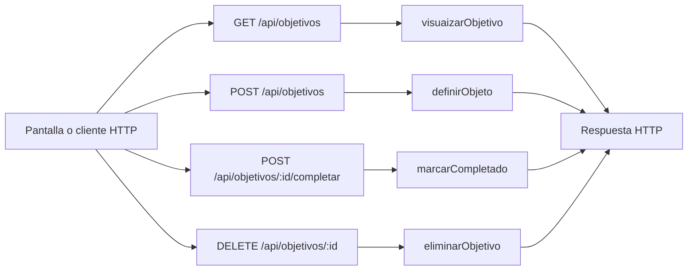

# Paulo López · endpoints de objetivos personales

Edición **75**. Tu responsabilidad principal son los **4 endpoints de la tabla siguiente**. Las funciones auxiliares y las consultas a rutas de otros compañeros se distinguen más abajo. Esto es un reparto para estudiar y defender, no una declaración de quién escribió el código.

## Tus endpoints concretos

| Método y ruta completa | Ruta en el código | Handler real | Acceso |
| --- | --- | --- | --- |
| `GET /api/objetivos` | [routes/gimnasio.routes.js](../routes/gimnasio.routes.js#L15) | [visuaizarObjetivo](../controllers/objetivos.controller.js#L4) | Sesión requerida |
| `POST /api/objetivos` | [routes/gimnasio.routes.js](../routes/gimnasio.routes.js#L16) | [definirObjeto](../controllers/objetivos.controller.js#L27) | Sesión requerida |
| `POST /api/objetivos/:id/completar` | [routes/gimnasio.routes.js](../routes/gimnasio.routes.js#L17) | [marcarCompletado](../controllers/objetivos.controller.js#L206) | Sesión requerida |
| `DELETE /api/objetivos/:id` | [routes/gimnasio.routes.js](../routes/gimnasio.routes.js#L18) | [eliminarObjetivo](../controllers/objetivos.controller.js#L246) | Sesión requerida |

Las URLs de esta tabla incluyen `/api`. En React vas a ver llamadas como `axios.get("/cuenta")`: [App.jsx](../client/src/App.jsx) configura `axios.defaults.baseURL = "/api"`. No existe una ruta extra por cada función interna.

## Mapa de tus endpoints

En los endpoints privados, `verificarSesion` corre antes del handler. Las tablas y consultas concretas se explican por endpoint; el catálogo usa JSON local y `/ia/estado` lee configuración, no hacen consultas de negocio a MySQL.

## Explicación de cada endpoint

### `GET /api/objetivos`

**Qué recibe.** Sin body.

**Qué ejecuta y consulta.** `Objetivo.findAll` por usuario, excluye estado eliminado y ordena por fecha de inicio/id descendentes.

**Qué valida o decide.** Se conserva la grafía `visuaizarObjetivo` del UML. Listar no calcula el porcentaje; eso corresponde a `/progreso`.

**Respuesta correcta.** `200` → `{items: [...]}` con objetivos activos y completados.

**Errores propios.** `500` si no puede listar.

**Quién lo llama.** Objetivos.jsx: `cargar`. Rutinas.jsx y, en el 75, Nutricion.jsx también consultan este endpoint para sus selectores.

**Cómo mostrarlo.** Mostrar un objetivo activo y otro completado; explicar qué registros se excluyen.

### `POST /api/objetivos`

**Qué recibe.** Body: `nombre`, `tipo`, `valor_objetivo` numérico, `unidad`, `fecha_inicio`; opcionales `descripcion`, `frecuencia_semanal`, `fecha_fin_estimada`.

**Qué ejecuta y consulta.** Busca la última `MedicionFisica` y un posible `Objetivo` activo. Crea el objetivo con línea de base, medición vinculada y `usuario_activo`; registra `Bitacora`.

**Qué valida o decide.** Un único activo. Tipos: bajar_peso, ganar_masa_muscular, mejorar_resistencia, aumentar_frecuencia_entrenamiento, definir, mantener_peso. kg/%/km/entrenamientos deben corresponder al tipo; fechas válidas y fin no anterior al inicio.

**Respuesta correcta.** `201` → objetivo creado.

**Errores propios.** `400` por datos, unidad o meta incoherentes; `409` por falta de medidas u objetivo activo existente; `500` si falla.

**Quién lo llama.** Objetivos.jsx: `guardar`.

**Cómo mostrarlo.** Crear una meta coherente con la medición y explicar la línea de base y el rechazo de una segunda meta activa.

### `POST /api/objetivos/:id/completar`

**Qué recibe.** URL: `id` del objetivo. Body: `confirmar: true`.

**Qué ejecuta y consulta.** Busca `Objetivo` propio por id y actualiza estado a completado, libera `usuario_activo`, guarda fecha visible y `fecha_cierre` exacta; registra `Bitacora`.

**Qué valida o decide.** Solo admite un objetivo activo. No comprueba que el porcentaje medido haya llegado a 100: completar es una decisión manual.

**Respuesta correcta.** `200` → objetivo actualizado.

**Errores propios.** `400` sin confirmación; `404` si no es propio/no existe; `409` si ya no está activo; `500` si falla.

**Quién lo llama.** Objetivos.jsx: `cambiar(o, true)`.

**Cómo mostrarlo.** Cancelar primero y después completar una meta de prueba; explicar por qué el momento de cierre se conserva.

### `DELETE /api/objetivos/:id`

**Qué recibe.** URL: `id`. Body: `confirmar: true`.

**Qué ejecuta y consulta.** Busca el objetivo propio, cambia estado a eliminado y libera `usuario_activo`; registra `Bitacora`. No destruye la fila ni las referencias históricas de los planes.

**Qué valida o decide.** Es una baja lógica y exige confirmación.

**Respuesta correcta.** `204` sin JSON.

**Errores propios.** `400` sin confirmación; `404` si no pertenece a la cuenta/no existe; `409` si ya estaba eliminado; `500` por fallo.

**Quién lo llama.** Objetivos.jsx: `cambiar(o, false)`.

**Cómo mostrarlo.** Explicar la diferencia entre dejar de mostrar una meta y borrar una cuenta definitivamente.

## Funciones de apoyo: no son otros endpoints

Conocé para qué sirven cuando aparecen en el recorrido de tus rutas. No se asigna una ruta inexistente ni se cambia el responsable por compartir una función.

| Función auxiliar | Para qué interviene |
| --- | --- |
| Lógica dentro de los handlers | No tiene una función auxiliar local adicional asignada. Consultá las relaciones de modelos y las funciones React del recorrido. |

## Archivos que tenés que ubicar

- [controllers/objetivos.controller.js](../controllers/objetivos.controller.js): handlers y lógica de tus endpoints.
- [client/src/pages/Objetivos.jsx](../client/src/pages/Objetivos.jsx): estado, formulario o carga que llama a esas rutas.
- [models/index.js](../models/index.js): relaciones; seguí desde ahí solo los modelos usados en tus consultas.
- [auth.controller.js](../controllers/auth.controller.js#L5): antes de un handler privado comprueba cookie, JWT, sesión persistida y cuenta activa; deja el usuario en `req.user`.

## Lo mínimo común para defender estas rutas

Diferenciá `req.params` (id en la URL), `req.query` (filtros después de `?`), `req.body` (JSON enviado) y `req.user` (cuenta autenticada). El usuario propietario se toma de la sesión, no de un id arbitrario enviado por el formulario.

Todos los endpoints privados pueden responder `401` si la sesión falta, vence, se cierra o la cuenta no está habilitada; el middleware puede responder `500` si falla su comprobación. No confundas estos errores compartidos con los que devuelve el handler. El parser general también puede rechazar JSON inválido (`400`) o un body demasiado grande (`413`).

Para respuestas `204`, no hay JSON que leer. Para crear suele usarse `201`; para leer/editar, `200`. En Axios, el JSON está en `respuesta.data`; en DELETE, el body se pasa como `{data: {...}}`.

No hace falta estudiar todo el sistema ni el funcionamiento interno de Vite. Sí poder seguir tu request desde la pantalla hasta las consultas y explicar una respuesta de éxito y una condición de error.

## Librerías que intervienen

Express y Sequelize, con Op para filtros; Intl de JavaScript calcula fechas en la zona de la cuenta. React y Axios muestran y envían las metas.

## Coordinación con otros responsables

- `GET /api/mediciones`: responsable **Gade Silva y Lápiz**. Entendé qué recibe y devuelve; no se vuelve a asignar como endpoint tuyo.

Consultá el [reparto completo](README.md) y el [alcance](../docs/ALCANCE.md) antes de prometer una ruta de otra entrega.

## Cómo leer el código simplificado

El recorrido sigue siendo pantalla React → ruta Express → controlador → modelo Sequelize → MySQL. No hay una capa de servicios. Las decisiones de negocio usan `if`/`else` y los recorridos usan `for (let i = 0; i < lista.length; i++)`. En cada vuelta, `lista[i]` es el elemento de esa posición; el nombre de la lista no tiene significado especial para JavaScript.

Se quitaron `for...of`, `?.`, `??` y `...` del código de controladores y pantallas. Los controladores ya no usan callbacks de `map`, `filter`, `find` o `some` ni comparadores de `sort`: las búsquedas, validaciones y cálculos están desplegados en bucles. En los formularios se construye una copia con los campos explícitos antes de llamar al setter de React; `slice()` copia una lista y `push()` agrega un elemento. No hay que modificar directamente el estado anterior.

En JSX se mantiene `map` únicamente para dibujar listas de elementos. Por ejemplo, `items.map((rutina) => <...>)` produce un bloque visual por rutina; no guarda datos ni llama a MySQL. `key` identifica cada fila para React. Algunas etiquetas usan un condicional sencillo `condicion ? textoSi : textoNo`; la validación del servidor está escrita con `if`. Las funciones de evento con `=>` y la desestructuración también aparecen en los ejemplos del curso: no son otra arquitectura.

No se afirma que todo el proyecto sea idéntico al repaso. El sistema tiene más funciones que un CRUD de ejemplo. Las protecciones conservadas se explican abajo según tu recorrido. [Criterio y diferencias conservadas](../docs/CRITERIO-DEL-PROFESOR.md).

### Tu recorrido, paso a paso

`definirObjeto` valida nombre, tipo, fechas y unidad; busca la última medición y comprueba que no exista otro objetivo activo. Usa `if`/`else` para elegir el valor inicial según el tipo: peso, porcentaje de grasa, distancia o frecuencia. No calcula el avance en esta operación.

En React, `unidad` se decide con `if`/`else if`; un bucle determina `hayObjetivoActivo`. `guardar` arma explícitamente los campos del body y convierte los numéricos con `Number`. `cambiar` distingue completar de eliminar y solicita confirmación. La fecha de cierre evita que mediciones futuras cambien el resultado de un objetivo terminado; el cálculo de progreso lo consulta otro endpoint.
