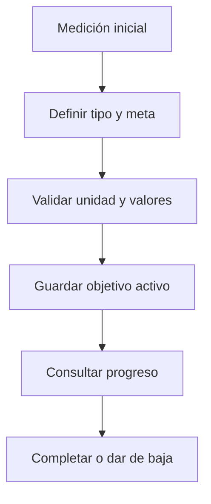

# Paulo López · Objetivos

Responsabilidad de estudio y revisión de la edición 75; no es una declaración de autoría.

## Mapa mental

## Archivos y funciones

Pantalla: [Objetivos.jsx](../client/src/pages/Objetivos.jsx). Backend: [controllers/objetivos.controller.js](../controllers/objetivos.controller.js). Las rutas están en [usuarios.routes.js](../routes/usuarios.routes.js) y [gimnasio.routes.js](../routes/gimnasio.routes.js).

| Función | Qué hace y qué tenés que poder explicar |
| --- | --- |
| [visuaizarObjetivo](../controllers/objetivos.controller.js#L5) | Consulta metas propias que no estén dadas de baja. |
| [definirObjeto](../controllers/objetivos.controller.js#L22) | Valida tipo/unidad/meta y fechas, exige medición inicial y un único objetivo activo; guarda la línea de base. |
| [marcarCompletado](../controllers/objetivos.controller.js#L172) | Requiere confirmación, marca la fecha y libera el lugar para otro objetivo activo. |
| [eliminarObjetivo](../controllers/objetivos.controller.js#L201) | Da de baja la meta sin borrar sus referencias históricas en planes. |

## Librerías

React, Axios y Sequelize. La restricción única usuario_activo permite un solo objetivo activo incluso ante dos solicitudes. Intl calcula la fecha según la zona de la cuenta.

## Qué entender

Peso usa kg, definición usa porcentaje de grasa, resistencia km y frecuencia entrenamientos semanales. Para perder peso la meta debe ser menor; para ganar masa, mayor. El progreso no marca completado automáticamente. Los nombres con grafías particulares vienen del UML.

Ubicá useState, useEffect cuando se use, los eventos del formulario y las llamadas Axios. Para cada función explicá entradas, validación, consulta y respuesta; no hace falta memorizar palabra por palabra.

## Recorrido de defensa

Cargá una medida. Creá una meta coherente. Mostrá que no permite otra activa. Completala y explicá que se conserva en el historial; cancelá también una confirmación antes de aceptar otra.

## Base común

Pantalla → ruta → controlador → modelo → MySQL. Las relaciones están en [models/index.js](../models/index.js). La confirmación está en [Confirmar.jsx](../client/src/components/Confirmar.jsx). Consultá el [alcance](../docs/ALCANCE.md). Vite solo inicia o compila React; no es una función del gimnasio ni hay que estudiar sus mecanismos internos.
