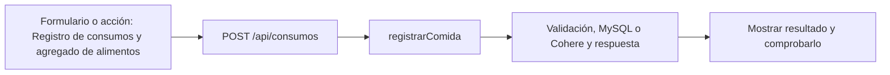

# Gade Silva y Lápiz · próximo avance

**Tarea nueva:** Registro de consumos y agregado de alimentos.

**Estado: pendiente de trabajo y verificación individual.** No es una declaración de que ya lo programaste. Se conserva tu responsabilidad de base del 50 % y se añade un recorrido concreto del incremento.

## Qué tenés que hacer ahora

Registrar lo realmente comido, manejar fecha/hora y agregar alimentos desde el editor común. Comprobar que cambiar gramos cambia el resultado. Revisar el detalle de comida guardado con Valentín, sin sumar planes como consumo.

## Mapa de tu avance

## Tus endpoints y continuidad

| Etapa | Método y ruta | Handler real |
| --- | --- | --- |
| Base del 50 % | `GET /api/mediciones` | [listarMediciones](../controllers/mediciones.controller.js#L204) |
| Base del 50 % | `POST /api/mediciones/initial` | [actualizarMedicion](../controllers/mediciones.controller.js#L55) |
| Base del 50 % | `POST /api/mediciones` | [actualizarMedicion](../controllers/mediciones.controller.js#L55) |
| Avance nuevo | `POST /api/consumos` | [registrarComida](../controllers/nutricion.controller.js#L340) |

## Funciones concretas del avance

| Función | Qué parte recorrés |
| --- | --- |
| [registrarComida](../controllers/nutricion.controller.js#L340) | Tu rama crea un consumo sin id y recalcula nutrientes. |
| [copiarAlimento](../client/src/pages/Nutricion.jsx#L72) | Copia explícita de los campos de un alimento. |
| [agregarAlimento](../client/src/pages/Nutricion.jsx#L270) | Agrega un alimento al editor común. |
| [actualizarComida](../controllers/nutricion.controller.js#L96) | Revisión conjunta con Valentín: la misma comida validada se persiste como detalle de dieta. |

Los helpers son funciones internas, no endpoints adicionales. Si una función sirve a POST y PUT o a generación y adaptación, se revisa entre los dos responsables. No hay que duplicarla ni separarla artificialmente para aparentar más código.

## Entradas, consultas y respuestas de tus rutas

### `GET /api/mediciones`

**Qué recibe.** Sin body ni query.

**Qué ejecuta y consulta.** `MedicionFisica.findAll` por `usuario_id`, ordenado por `fecha_medicion DESC`.

**Qué valida o decide.** No acepta un usuario_id del navegador para consultar otra cuenta.

**Respuesta correcta.** `200` → `{items: [...]}`; puede estar vacío.

**Errores propios.** `500` si no puede consultar.

**Quién lo llama.** Medidas.jsx: `cargar`.

**Cómo mostrarlo.** Mostrar el historial con dos registros, indicando cuál es el más reciente.

### `POST /api/mediciones/initial`

**Qué recibe.** Body: `peso_kg`, `altura_cm`, `nivel_actividad`; opcionales `grasa_corporal`, `musculo_corporal`, `fecha_medicion`, `cintura_cm`, `pecho_cm`, `brazos_cm`, `piernas_cm`.

**Qué ejecuta y consulta.** Busca la última medición propia; si no existe crea `MedicionFisica` con `usuario_inicial = req.user.id` y registra `Bitacora`.

**Qué valida o decide.** La función detecta la ruta `/initial`. Rechaza una segunda carga inicial. Peso 20–400 kg, altura 80–250 cm, grasa 0–70 %, músculo 0–100 %, suma de porcentajes ≤100; actividad baja/media/alta. Fecha no futura; perímetros mayores que 0 y hasta 300 cm.

**Respuesta correcta.** `201` → fila de medición creada.

**Errores propios.** `400` por valores/fechas inválidos; `409` si ya existe inicial; `500` si no puede guardar.

**Quién lo llama.** Medidas.jsx: `guardar` elige `/mediciones/initial` cuando la lista está vacía.

**Cómo mostrarlo.** Registrar el punto de partida; explicar por qué este endpoint no se usa de nuevo.

### `POST /api/mediciones`

**Qué recibe.** Body: `peso_kg`, `altura_cm`, `nivel_actividad`; opcionales `grasa_corporal`, `musculo_corporal`, `fecha_medicion`, `cintura_cm`, `pecho_cm`, `brazos_cm`, `piernas_cm`.

**Qué ejecuta y consulta.** Busca la última medición propia; crea otra fila de `MedicionFisica` y agrega `Bitacora`, sin sobrescribir la anterior.

**Qué valida o decide.** Debe haber una medición previa y la nueva fecha debe ser posterior. Peso 20–400 kg, altura 80–250 cm, grasa 0–70 %, músculo 0–100 %, suma de porcentajes ≤100; actividad baja/media/alta. Fecha no futura; perímetros mayores que 0 y hasta 300 cm.

**Respuesta correcta.** `201` → nueva fila del historial.

**Errores propios.** `400` por datos o fecha no posterior; `409` si todavía falta la inicial; `500` si falla el guardado.

**Quién lo llama.** Medidas.jsx: `guardar` elige `/mediciones` si ya hay registros.

**Cómo mostrarlo.** Agregar una medición posterior y mostrar que conserva la inicial.

### `POST /api/consumos`

**Qué recibe.** Body: `nombre_comida`, `tipo_comida`, `fecha_consumo` como instante ISO y `alimentos` (1–30). Cada alimento incluye nombre, cantidad, unidad g/ml/porcion y sus calorías/proteínas/carbohidratos/grasas por 100 g/ml o una porción.

**Qué ejecuta y consulta.** `datosComida` llama a `calcularMacros`; crea una fila `ComidaConsumida` con propietario, instante, copia de alimentos y totales.

**Qué valida o decide.** Fecha válida desde el año 2000 y no futura. Se recalculan totales en el servidor; un total enviado aparte por el cliente no reemplaza este cálculo. Cantidades positivas y nutrientes válidos.

**Respuesta correcta.** `201` → consumo creado con `calorias_totales`, `proteinas_totales_g`, `carbohidratos_totales_g`, `grasas_totales_g`.

**Errores propios.** `400` por alimento, cantidad o fecha inválidos; `500` si falla.

**Quién lo llama.** Nutricion.jsx modo consumos: `guardar` sin id editando; vacío en fecha/hora del formulario se convierte al instante actual antes de enviar.

**Cómo mostrarlo.** Ingresar 50 g de un alimento de 400 kcal/100 g y comprobar que registra 200 kcal.

## Cuándo está terminado tu bloque

- [ ] 50 g a 400 kcal/100 g produce 200 kcal.
- [ ] Agregar un alimento conserva los valores del anterior.
- [ ] La fecha futura se rechaza; el día consultado respeta zona horaria.
- [ ] Explicar el recorrido desde el input hasta la respuesta, sin leer el código palabra por palabra.
- [ ] Registrar qué revisión, cambio o comprobación hiciste realmente; si hay commit, usar la identidad real.

## Tamaño previsto y trabajo compartido

Como referencia, este paquete cubre **10.06 %** de las 1.702 líneas nuevas/reemplazadas del incremento medido. Es cobertura asignada para revisar/trabajar, no un porcentaje de programación ya hecho. No mide dificultad ni tiempo y se reajusta si al trabajar aparece una diferencia de carga.

[Plan y límites del cálculo](../docs/PLAN.md). La meta es cerca de 11 % por persona, con margen; el alcance de entrega puede quedar por encima o por debajo del nombre histórico 75. No se inflan líneas ni se atribuye código intacto como una mejora.

## Lectura del código

Pantalla React → ruta Express → controlador → Sequelize → MySQL. req.params trae el id; req.query, filtros; req.body, JSON; req.user, la cuenta autenticada. Las consultas deben restringir el propietario. Axios envía pedidos desde React y el JSON recibido está en respuesta.data. Un 204 no tiene JSON.

El backend usa for tradicional, if/else, async/await y try/catch. En JSX, map dibuja listas. Las transacciones con commit/rollback evitan guardados parciales; el cifrado, hash y sesión conservan cuentas y datos existentes. La clave de Cohere permanece en el servidor. No se reintroducen los temas retirados ni capas de servicios.

[Criterio del profesor y diferencias conservadas](../docs/CRITERIO-DEL-PROFESOR.md).
