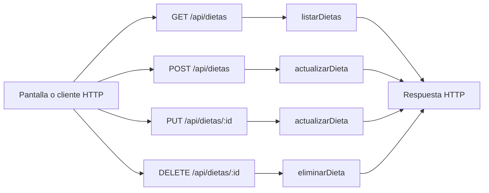

# Valentín Schueld (Sueco) · endpoints de dietas manuales

Edición **75**. Tu responsabilidad principal son los **4 endpoints de la tabla siguiente**. Las funciones auxiliares y las consultas a rutas de otros compañeros se distinguen más abajo. Esto es un reparto para estudiar y defender, no una declaración de quién escribió el código.

## Tus endpoints concretos

| Método y ruta completa | Ruta en el código | Handler real | Acceso |
| --- | --- | --- | --- |
| `GET /api/dietas` | [routes/gimnasio.routes.js](../routes/gimnasio.routes.js#L27) | [listarDietas](../controllers/nutricion.controller.js#L94) | Sesión requerida |
| `POST /api/dietas` | [routes/gimnasio.routes.js](../routes/gimnasio.routes.js#L28) | [actualizarDieta](../controllers/nutricion.controller.js#L107) | Sesión requerida |
| `PUT /api/dietas/:id` | [routes/gimnasio.routes.js](../routes/gimnasio.routes.js#L29) | [actualizarDieta](../controllers/nutricion.controller.js#L107) | Sesión requerida |
| `DELETE /api/dietas/:id` | [routes/gimnasio.routes.js](../routes/gimnasio.routes.js#L30) | [eliminarDieta](../controllers/nutricion.controller.js#L224) | Sesión requerida |

Las URLs de esta tabla incluyen `/api`. En React vas a ver llamadas como `axios.get("/cuenta")`: [App.jsx](../client/src/App.jsx) configura `axios.defaults.baseURL = "/api"`. No existe una ruta extra por cada función interna.

## Mapa de tus endpoints

En los endpoints privados, `verificarSesion` corre antes del handler. Las tablas y consultas concretas se explican por endpoint; el catálogo usa JSON local y `/ia/estado` lee configuración, no hacen consultas de negocio a MySQL.

## Explicación de cada endpoint

### `GET /api/dietas`

**Qué recibe.** Sin body.

**Qué ejecuta y consulta.** `Dieta.findAll` propia, no eliminada, con `include` de `DietaComida`, ordenada por creación descendente.

**Qué valida o decide.** El listado trae comidas y alimentos; no hay endpoint GET /dietas/:id en esta versión. Una dieta planificada no cuenta como consumo.

**Respuesta correcta.** `200` → `{items: [...]}`.

**Errores propios.** `500` si no puede consultar.

**Quién lo llama.** Nutricion.jsx con modo dietas: `cargar`.

**Cómo mostrarlo.** Mostrar las comidas de una dieta y diferenciar sus objetivos de los nutrientes calculados.

### `POST /api/dietas`

**Qué recibe.** Body: `nombre`, `descripcion` string, `calorias_objetivo`, `proteinas_objetivo_g`, `carbohidratos_objetivo_g`, `grasas_objetivo_g`, `comidas` (1–15); `objetivo_id` opcional. Cada comida: `nombre_comida`, `tipo_comida`, `hora` HH:mm, `alimentos` (1–30). Cada alimento: `nombre`, `cantidad`, `unidad` g/ml/porcion, `calorias`, `proteinas_g`, `carbohidratos_g`, `grasas_g` por 100 g/ml o una porción.

**Qué ejecuta y consulta.** Consulta el objetivo si corresponde. En una transacción crea `Dieta` tipo manual e inserta `DietaComida` mediante `actualizarComida`. Los alimentos se conservan como JSON dentro de cada comida.

**Qué valida o decide.** Metas numéricas 0–9000 (kcal enteras); nombres, tipos de comida y horarios válidos. `calcularMacros` recalcula desde alimentos y cantidades. Un objetivo nuevo asociado debe ser propio y activo.

**Respuesta correcta.** `201` → cabecera creada; la interfaz recarga GET /api/dietas para detalles.

**Errores propios.** `400` por entradas, alimentos, horario u objetivo inválidos; `500` si no puede guardar.

**Quién lo llama.** Nutricion.jsx modo dietas: `guardar` sin id editando.

**Cómo mostrarlo.** Crear un plan con desayuno y un alimento; mostrar que no suma automáticamente al consumo del día.

### `PUT /api/dietas/:id`

**Qué recibe.** URL `id` y body completo del POST /api/dietas.

**Qué ejecuta y consulta.** Busca `Dieta` propia activa. En una transacción actualiza cabecera, destruye sus `DietaComida` antiguas y crea el conjunto nuevo; no modifica `ComidaConsumida`.

**Qué valida o decide.** Metas numéricas 0–9000 (kcal enteras); nombres, tipos de comida y horarios válidos. `calcularMacros` recalcula desde alimentos y cantidades. Un objetivo nuevo asociado debe ser propio y activo. Puede mantener el mismo objetivo histórico completado que ya tenía asociado.

**Respuesta correcta.** `200` → cabecera actualizada.

**Errores propios.** `400` datos inválidos; `404` si no hay dieta propia activa; `500` por fallo.

**Quién lo llama.** Nutricion.jsx modo dietas: `editar` carga el formulario y `guardar` elige PUT.

**Cómo mostrarlo.** Cambiar horario y cantidad, guardar y explicar que los consumos previos conservan sus valores.

### `DELETE /api/dietas/:id`

**Qué recibe.** URL `id`; body `confirmar: true`.

**Qué ejecuta y consulta.** Busca `Dieta` propia activa y actualiza estado a eliminada y fecha de actualización.

**Qué valida o decide.** Baja lógica del plan. No borra alimentos consumidos ni registra que se haya comido nada.

**Respuesta correcta.** `204` sin JSON.

**Errores propios.** `400` sin confirmar; `404` si no hay dieta propia activa; `500` por fallo.

**Quién lo llama.** Nutricion.jsx modo dietas: `eliminar`.

**Cómo mostrarlo.** Cancelar una baja y explicar qué información se conservaría al confirmarla.

## Funciones de apoyo: no son otros endpoints

Conocé para qué sirven cuando aparecen en el recorrido de tus rutas. No se asigna una ruta inexistente ni se cambia el responsable por compartir una función.

| Función auxiliar | Para qué interviene |
| --- | --- |
| [datosComida](../controllers/nutricion.controller.js#L65) | Valida nombre/tipo y obtiene nutrientes calculados. |
| [calcularMacros](../controllers/nutricion.controller.js#L5) | Suma nutrientes proporcionales a la cantidad, con redondeo. |
| [actualizarComida](../controllers/nutricion.controller.js#L82) | Inserta una comida de dieta; no tiene una ruta HTTP independiente. |

## Archivos que tenés que ubicar

- [controllers/nutricion.controller.js](../controllers/nutricion.controller.js): handlers y lógica de tus endpoints.
- [client/src/pages/Nutricion.jsx](../client/src/pages/Nutricion.jsx): estado, formulario o carga que llama a esas rutas.
- [models/index.js](../models/index.js): relaciones; seguí desde ahí solo los modelos usados en tus consultas.
- [auth.controller.js](../controllers/auth.controller.js#L6): antes de un handler privado comprueba cookie, JWT, sesión persistida y cuenta activa; deja el usuario en `req.user`.

## Lo mínimo común para defender estas rutas

Diferenciá `req.params` (id en la URL), `req.query` (filtros después de `?`), `req.body` (JSON enviado) y `req.user` (cuenta autenticada). El usuario propietario se toma de la sesión, no de un id arbitrario enviado por el formulario.

Todos los endpoints privados pueden responder `401` si la sesión falta, vence, se cierra o la cuenta no está habilitada; el middleware puede responder `500` si falla su comprobación. No confundas estos errores compartidos con los que devuelve el handler. El parser general también puede rechazar JSON inválido (`400`) o un body demasiado grande (`413`).

Para respuestas `204`, no hay JSON que leer. Para crear suele usarse `201`; para leer/editar, `200`. En Axios, el JSON está en `respuesta.data`; en DELETE, el body se pasa como `{data: {...}}`.

No hace falta estudiar todo el sistema ni el funcionamiento interno de Vite. Sí poder seguir tu request desde la pantalla hasta las consultas y explicar una respuesta de éxito y una condición de error.

## Librerías que intervienen

Express, Sequelize, React y Axios. Los bucles/arrays son JavaScript; los detalles se guardan con Sequelize dentro de una transacción. Los alimentos se conservan como JSON en las comidas del plan; calcularMacros es una función propia, no una librería nutricional.

## Coordinación con otros responsables

- `GET /api/objetivos`: responsable **Paulo López**. Entendé qué recibe y devuelve; no se vuelve a asignar como endpoint tuyo.

Consultá el [reparto completo](README.md) y el [alcance](../docs/ALCANCE.md) antes de prometer una ruta de otra entrega.
