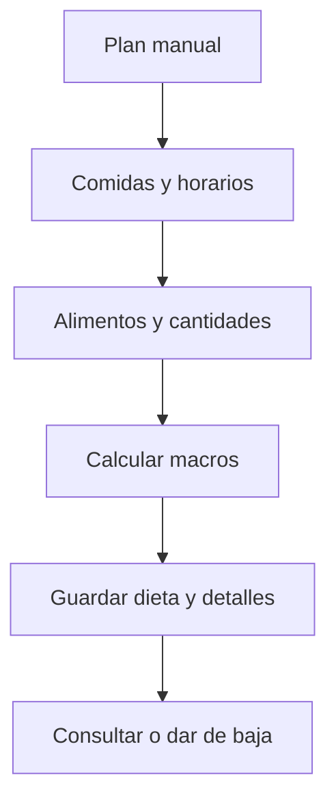

# Valentín Schueld (Sueco) · Dietas manuales y comidas planificadas

Responsabilidad de estudio y revisión de la edición 75; no es una declaración de autoría.

## Mapa mental

## Archivos y funciones

Pantalla: [Nutricion.jsx](../client/src/pages/Nutricion.jsx). Backend: [controllers/nutricion.controller.js](../controllers/nutricion.controller.js). Las rutas están en [usuarios.routes.js](../routes/usuarios.routes.js) y [gimnasio.routes.js](../routes/gimnasio.routes.js).

| Función | Qué hace y qué tenés que poder explicar |
| --- | --- |
| [listarDietas](../controllers/nutricion.controller.js#L94) | Carga planes propios activos y sus comidas. |
| [actualizarDieta](../controllers/nutricion.controller.js#L107) | Valida nombre, metas, objetivo y comidas; crea o reemplaza cabecera y detalles en una transacción. |
| [actualizarComida](../controllers/nutricion.controller.js#L82) | Valida el horario y guarda una comida del plan con macros calculados. |
| [eliminarDieta](../controllers/nutricion.controller.js#L224) | Da de baja la dieta, sin eliminar lo efectivamente consumido. |

## Librerías

React y Axios; Sequelize para Dieta/DietaComida/Objetivo; transacción explícita para evitar guardar el plan incompleto. No hay IA de dietas en este corte.

## Qué entender

Dieta es plan, no consumo. Las metas de calorías/macros son distintas de los nutrientes calculados de las comidas. Una edición reemplaza las comidas planificadas pero no cambia el consumo histórico. Hora usa HH:mm y objetivo debe ser propio.

Ubicá useState, useEffect cuando se use, los eventos del formulario y las llamadas Axios. Para cada función explicá entradas, validación, consulta y respuesta; no hace falta memorizar palabra por palabra.

## Recorrido de defensa

Creá una dieta con desayuno y un alimento. Editá el horario. Mostrá las calorías del plan y explicá que todavía no suma al consumo del día. Cancelá la baja para mostrar la confirmación.

## Base común

Pantalla → ruta → controlador → modelo → MySQL. Las relaciones están en [models/index.js](../models/index.js). La confirmación está en [Confirmar.jsx](../client/src/components/Confirmar.jsx). Consultá el [alcance](../docs/ALCANCE.md). Vite solo inicia o compila React; no es una función del gimnasio ni hay que estudiar sus mecanismos internos.
