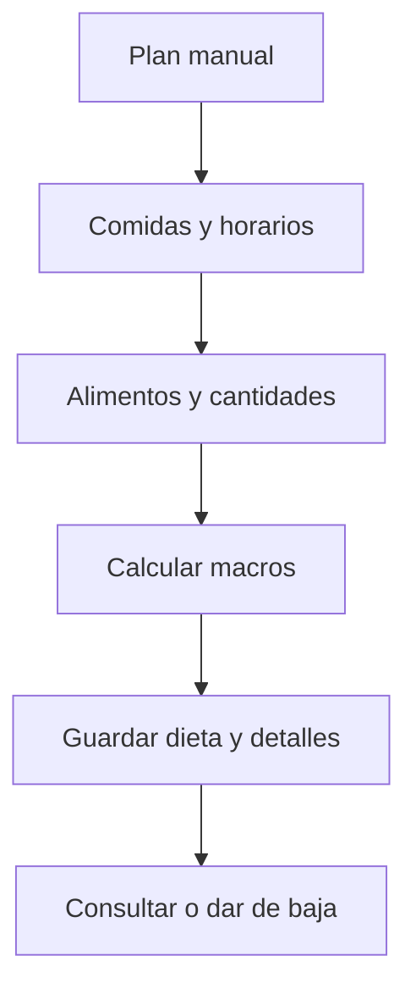

# Valentín Schueld (Sueco) · Dietas manuales y comidas planificadas

Esta es tu responsabilidad de estudio y revisión. No declara quién escribió el código.

## Mapa mental

## Archivos y funciones

Pantalla: [client/src/pages/Nutricion.jsx](../client/src/pages/Nutricion.jsx). Backend: [controllers/nutricion.controller.js](../controllers/nutricion.controller.js). Rutas de cuentas en [usuarios.routes.js](../routes/usuarios.routes.js); las demás en [gimnasio.routes.js](../routes/gimnasio.routes.js).

| Función | Qué hace y qué tenés que poder explicar |
| --- | --- |
| [listarDietas](../controllers/nutricion.controller.js#L94) | Carga planes propios activos y sus comidas. |
| [actualizarDieta](../controllers/nutricion.controller.js#L107) | Valida nombre, metas, objetivo y comidas; crea o reemplaza cabecera y detalles en una transacción. |
| [actualizarComida](../controllers/nutricion.controller.js#L82) | Valida el horario y guarda una comida del plan con macros calculados. |
| [eliminarDieta](../controllers/nutricion.controller.js#L224) | Da de baja la dieta, sin eliminar lo efectivamente consumido. |

## Librerías que intervienen

React y Axios; Sequelize para Dieta/DietaComida/Objetivo; transacción explícita para evitar guardar el plan incompleto. No hay IA de dietas en este corte.

## Qué tenés que entender

Dieta es plan, no consumo. Las metas de calorías/macros son distintas de los nutrientes calculados de las comidas. Una edición reemplaza las comidas planificadas pero no cambia el consumo histórico. Hora usa HH:mm y objetivo debe ser propio.

En la pantalla ubicá los estados (useState), la carga inicial (useEffect), el submit y las llamadas Axios. Seguí la ruta hasta la función del controlador y el modelo. Entendé qué datos entran, qué se valida, qué consulta se ejecuta y qué respuesta se devuelve. No hace falta memorizar cada palabra, pero sí poder explicar una función y una condición de error.

## Recorrido para defenderlo

Creá una dieta con desayuno y un alimento. Editá el horario. Mostrá las calorías del plan y explicá que todavía no suma al consumo del día. Cancelá la baja para mostrar la confirmación.

## Base común mínima

Todos deben poder explicar `pantalla → ruta → controlador → modelo → MySQL`, request/response, async/await y try/catch. Las relaciones están en [models/index.js](../models/index.js). La confirmación visible está en [Confirmar.jsx](../client/src/components/Confirmar.jsx): muestra aceptar/cancelar; el servidor vuelve a exigir confirmación. Consultá [el alcance](../docs/ALCANCE.md) antes de prometer funciones del sistema completo.
