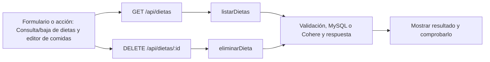

# Valentín Schueld (Sueco) · próximo avance

**Tarea nueva:** Consulta/baja de dietas y editor de comidas.

**Estado: pendiente de trabajo y verificación individual.** No es una declaración de que ya lo programaste. Se conserva tu responsabilidad de base del 50 % y se añade un recorrido concreto del incremento.

## Qué tenés que hacer ahora

Mostrar planes guardados y dar uno de baja con confirmación. Completar el editor de nombre/tipo/hora de comida y agregar/quitar comidas sin perder datos. Revisar persistencia del detalle con Gade.

## Mapa de tu avance

## Tus endpoints y continuidad

| Etapa | Método y ruta | Handler real |
| --- | --- | --- |
| Base del 50 % | `POST /api/rutinas` | [actualizarRutina](../controllers/rutinas.controller.js#L229) |
| Base del 50 % | `PUT /api/rutinas/:id` | [actualizarRutina](../controllers/rutinas.controller.js#L229) |
| Base del 50 % | `DELETE /api/rutinas/:id` | [eliminarRutina](../controllers/rutinas.controller.js#L324) |
| Avance nuevo | `GET /api/dietas` | [listarDietas](../controllers/nutricion.controller.js#L123) |
| Avance nuevo | `DELETE /api/dietas/:id` | [eliminarDieta](../controllers/nutricion.controller.js#L310) |

## Funciones concretas del avance

| Función | Qué parte recorrés |
| --- | --- |
| [listarDietas](../controllers/nutricion.controller.js#L123) | Consulta propia con detalles. |
| [eliminarDieta](../controllers/nutricion.controller.js#L310) | Baja lógica confirmada; no suma ni borra consumos. |
| [copiarComida](../client/src/pages/Nutricion.jsx#L83) | Copia los campos de una comida del editor. |
| [actualizarComidas](../client/src/pages/Nutricion.jsx#L279) | Actualiza la colección de comidas sin mutar estado. |
| [agregarComida](../client/src/pages/Nutricion.jsx#L300) | Agrega una comida nueva al plan. |
| [quitarComida](../client/src/pages/Nutricion.jsx#L291) | Quita una comida elegida del editor. |
| [actualizarComida](../controllers/nutricion.controller.js#L96) | Detalle de dieta; revisión conjunta con Gade, que maneja alimentos compartidos. |

Los helpers son funciones internas, no endpoints adicionales. Si una función sirve a POST y PUT o a generación y adaptación, se revisa entre los dos responsables. No hay que duplicarla ni separarla artificialmente para aparentar más código.

## Entradas, consultas y respuestas de tus rutas

### `POST /api/rutinas`

**Qué recibe.** Body: `nombre`, `ejercicios` (1–80); opcionales `descripcion`, `objetivo_id`. Cada ejercicio: `nombre_ejercicio` o `ejercicio_id` del catálogo, `dia_semana` (1–7), `series`, `repeticiones`, `peso_sugerido_kg`, `descanso_segundos`; opcionales `orden` y `observaciones`.

**Qué ejecuta y consulta.** Consulta `Objetivo` si se vinculó. `guardarRutina` crea `Rutina` y `actualizarRutinaEjercicio` inserta las filas `RutinaEjercicio`, todo en una transacción.

**Qué valida o decide.** Nombre 2–100; series 1–20; repeticiones 1–200; carga 0–600; descanso entero 0–900; posición no repetida por día. Si hay id del catálogo, el servidor toma su nombre/grupo. Un objetivo nuevo debe ser propio y activo.

**Respuesta correcta.** `201` → cabecera de la rutina; para ver ejercicios completos se vuelve a consultar `GET /api/rutinas`.

**Errores propios.** `400` por cabecera, ejercicio u objetivo inválido; `500` si falla el guardado.

**Quién lo llama.** Rutinas.jsx: `guardar` sin `editando`; calcula `orden` al recorrer la lista.

**Cómo mostrarlo.** Crear una rutina con un ejercicio manual y otro del catálogo; explicar cómo se guarda cabecera y detalle.

### `PUT /api/rutinas/:id`

**Qué recibe.** URL `id` + el mismo body completo que POST /api/rutinas. No es una edición parcial.

**Qué ejecuta y consulta.** Busca `Rutina` propia activa y objetivo si corresponde. En una transacción actualiza cabecera, elimina sus antiguos `RutinaEjercicio` e inserta el nuevo conjunto.

**Qué valida o decide.** Nombre 2–100; series 1–20; repeticiones 1–200; carga 0–600; descanso entero 0–900; posición no repetida por día. Si hay id del catálogo, el servidor toma su nombre/grupo. Un objetivo nuevo debe ser propio y activo. Puede conservar el mismo objetivo histórico ya asociado aunque esté completado. Los ejercicios de entrenamientos iniciados antes son copias independientes.

**Respuesta correcta.** `200` → cabecera actualizada; la pantalla recarga el listado.

**Errores propios.** `400` por datos/objetivo inválidos; `404` si no hay rutina propia activa; `500` por fallo.

**Quién lo llama.** Rutinas.jsx: `editar` llena el formulario y `guardar` usa PUT cuando hay id editando.

**Cómo mostrarlo.** Cambiar series, guardar y comprobar que un entrenamiento anterior mantiene lo que tenía registrado.

### `DELETE /api/rutinas/:id`

**Qué recibe.** URL `id`; body `confirmar: true`.

**Qué ejecuta y consulta.** Busca `Rutina` propia activa; busca un `Entrenamiento` iniciado de ese plan. Si no hay, actualiza estado a eliminada y fecha de actualización.

**Qué valida o decide.** Baja lógica: conserva los entrenamientos. No permite dar de baja un plan con sesión abierta.

**Respuesta correcta.** `204` sin JSON.

**Errores propios.** `400` sin confirmar; `404` si no encuentra plan propio activo; `409` si hay entrenamiento en curso; `500` si falla.

**Quién lo llama.** Rutinas.jsx: `eliminar`.

**Cómo mostrarlo.** Intentar la baja durante un entrenamiento y explicar el 409; cerrar antes o cancelar la baja.

### `GET /api/dietas`

**Qué recibe.** Sin body.

**Qué ejecuta y consulta.** `Dieta.findAll` propia, no eliminada, con `include` de `DietaComida`, ordenada por creación descendente.

**Qué valida o decide.** El listado trae comidas y alimentos; no hay endpoint GET /dietas/:id en esta versión. Una dieta planificada no cuenta como consumo.

**Respuesta correcta.** `200` → `{items: [...]}`.

**Errores propios.** `500` si no puede consultar.

**Quién lo llama.** Nutricion.jsx con modo dietas: `cargar`.

**Cómo mostrarlo.** Mostrar las comidas de una dieta y diferenciar sus objetivos de los nutrientes calculados.

### `DELETE /api/dietas/:id`

**Qué recibe.** URL `id`; body `confirmar: true`.

**Qué ejecuta y consulta.** Busca `Dieta` propia activa y actualiza estado a eliminada y fecha de actualización.

**Qué valida o decide.** Baja lógica del plan. No borra alimentos consumidos ni registra que se haya comido nada.

**Respuesta correcta.** `204` sin JSON.

**Errores propios.** `400` sin confirmar; `404` si no hay dieta propia activa; `500` por fallo.

**Quién lo llama.** Nutricion.jsx modo dietas: `eliminar`.

**Cómo mostrarlo.** Cancelar una baja y explicar qué información se conservaría al confirmarla.

## Cuándo está terminado tu bloque

- [ ] Listar solo dietas propias y mostrar sus comidas.
- [ ] Agregar y quitar una comida conserva las otras.
- [ ] Cancelar baja conserva el plan; confirmar lo excluye de los activos sin alterar consumos.
- [ ] Explicar el recorrido desde el input hasta la respuesta, sin leer el código palabra por palabra.
- [ ] Registrar qué revisión, cambio o comprobación hiciste realmente; si hay commit, usar la identidad real.

## Tamaño previsto y trabajo compartido

Como referencia, este paquete cubre **12.81 %** de las 1.702 líneas nuevas/reemplazadas del incremento medido. Es cobertura asignada para revisar/trabajar, no un porcentaje de programación ya hecho. No mide dificultad ni tiempo y se reajusta si al trabajar aparece una diferencia de carga.

[Plan y límites del cálculo](../docs/PLAN.md). La meta es cerca de 11 % por persona, con margen; el alcance de entrega puede quedar por encima o por debajo del nombre histórico 75. No se inflan líneas ni se atribuye código intacto como una mejora.

## Lectura del código

Pantalla React → ruta Express → controlador → Sequelize → MySQL. req.params trae el id; req.query, filtros; req.body, JSON; req.user, la cuenta autenticada. Las consultas deben restringir el propietario. Axios envía pedidos desde React y el JSON recibido está en respuesta.data. Un 204 no tiene JSON.

El backend usa for tradicional, if/else, async/await y try/catch. En JSX, map dibuja listas. Las transacciones con commit/rollback evitan guardados parciales; el cifrado, hash y sesión conservan cuentas y datos existentes. La clave de Cohere permanece en el servidor. No se reintroducen los temas retirados ni capas de servicios.

[Criterio del profesor y diferencias conservadas](../docs/CRITERIO-DEL-PROFESOR.md).
