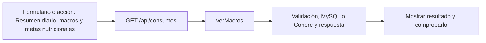

# Mateo Romani · próximo avance

**Tarea nueva:** Resumen diario, macros y metas nutricionales.

**Estado: pendiente de trabajo y verificación individual.** No es una declaración de que ya lo programaste. Se conserva tu responsabilidad de base del 50 % y se añade un recorrido concreto del incremento.

## Qué tenés que hacer ahora

Consultar un día, mostrar total de energía y macros, día vacío y referencia de dieta. Revisar los inputs de metas nutricionales del plan y su comparación con totales, sin asumir que el plan fue consumido.

## Mapa de tu avance

## Tus endpoints y continuidad

| Etapa | Método y ruta | Handler real |
| --- | --- | --- |
| Base del 50 % | `GET /api/progreso` | [verProgreso](../controllers/progreso.controller.js#L25) |
| Avance nuevo | `GET /api/consumos` | [verMacros](../controllers/nutricion.controller.js#L404) |

## Funciones concretas del avance

| Función | Qué parte recorrés |
| --- | --- |
| [verMacros](../controllers/nutricion.controller.js#L404) | Filtra por día local, suma nutrientes y compara con la dieta más reciente. |
| [cargar](../client/src/pages/Nutricion.jsx#L47) | Tu rama consulta GET /consumos cuando cambia el día; el listado de dietas corresponde a Valentín. |
| [verProgreso](../controllers/progreso.controller.js#L25) | Conservás el endpoint de progreso del 50 % y revisás el contador de dietas agregado. |

Los helpers son funciones internas, no endpoints adicionales. Si una función sirve a POST y PUT o a generación y adaptación, se revisa entre los dos responsables. No hay que duplicarla ni separarla artificialmente para aparentar más código.

## Entradas, consultas y respuestas de tus rutas

### `GET /api/progreso`

**Qué recibe.** Sin body ni id de usuario en la URL.

**Qué ejecuta y consulta.** Consulta `MedicionFisica`, `Objetivo` no eliminado, `Entrenamiento` completo y cuenta `Rutina` activa. En el 75 además cuenta `Dieta` activa. Agrupa/calcula valores en JavaScript.

**Qué valida o decide.** `calcularPorcentaje` compara inicio/actual/meta, limita a 0–100 y trata inicio=meta. Resistencia usa mejor distancia; frecuencia cuenta sesiones completas semanales. Objetivos completados cortan en `fecha_cierre`, incluso el mismo día.

**Respuesta correcta.** `200` → `{mediciones, objetivos: [...con valor_actual y porcentaje], entrenamientos_completados, rutinas}`; en 75 agrega `dietas`.

**Errores propios.** `500` si no puede consultar/calcular.

**Quién lo llama.** Progreso.jsx: `useEffect` carga el resumen y Recharts dibuja peso; es la pantalla Resumen, no una pestaña de Mi cuenta.

**Cómo mostrarlo.** Explicar el cálculo 80→70 con actual 75 =50 %, mostrar el gráfico y por qué una meta completada manualmente puede no medir 100 %.

### `GET /api/consumos`

**Qué recibe.** Query opcional: `fecha` YYYY-MM-DD. Si falta usa hoy en la zona horaria de la cuenta.

**Qué ejecuta y consulta.** Lee `ComidaConsumida` propia, filtra cada instante por su día local, suma macros y consulta la `Dieta` activa más reciente para comparar metas.

**Qué valida o decide.** Una fecha ISO inválida devuelve error. El consumo real y el plan no se suman entre sí. Este endpoint calcula totales; no escribe registros.

**Respuesta correcta.** `200` → `{fecha, items, totales: {calorias, proteinas_g, carbohidratos_g, grasas_g}, dieta}`; dieta puede ser null.

**Errores propios.** `400` fecha inválida; `500` si no puede consultar/calcular.

**Quién lo llama.** Nutricion.jsx modo consumos: `cargar` cuando cambia fecha.

**Cómo mostrarlo.** Consultar un día vacío y otro con consumo; explicar cómo 02:30 UTC puede pertenecer al día anterior en Buenos Aires.

## Cuándo está terminado tu bloque

- [ ] Un día sin consumos devuelve totales cero.
- [ ] Sumar dos consumos y comprobar cada nutriente.
- [ ] La meta de la dieta es una referencia y no otro consumo.
- [ ] Explicar el recorrido desde el input hasta la respuesta, sin leer el código palabra por palabra.
- [ ] Registrar qué revisión, cambio o comprobación hiciste realmente; si hay commit, usar la identidad real.

## Tamaño previsto y trabajo compartido

Como referencia, este paquete cubre **11.82 %** de las 1.702 líneas nuevas/reemplazadas del incremento medido. Es cobertura asignada para revisar/trabajar, no un porcentaje de programación ya hecho. No mide dificultad ni tiempo y se reajusta si al trabajar aparece una diferencia de carga.

[Plan y límites del cálculo](../docs/PLAN.md). La meta es cerca de 11 % por persona, con margen; el alcance de entrega puede quedar por encima o por debajo del nombre histórico 75. No se inflan líneas ni se atribuye código intacto como una mejora.

## Lectura del código

Pantalla React → ruta Express → controlador → Sequelize → MySQL. req.params trae el id; req.query, filtros; req.body, JSON; req.user, la cuenta autenticada. Las consultas deben restringir el propietario. Axios envía pedidos desde React y el JSON recibido está en respuesta.data. Un 204 no tiene JSON.

El backend usa for tradicional, if/else, async/await y try/catch. En JSX, map dibuja listas. Las transacciones con commit/rollback evitan guardados parciales; el cifrado, hash y sesión conservan cuentas y datos existentes. La clave de Cohere permanece en el servidor. No se reintroducen los temas retirados ni capas de servicios.

[Criterio del profesor y diferencias conservadas](../docs/CRITERIO-DEL-PROFESOR.md).
