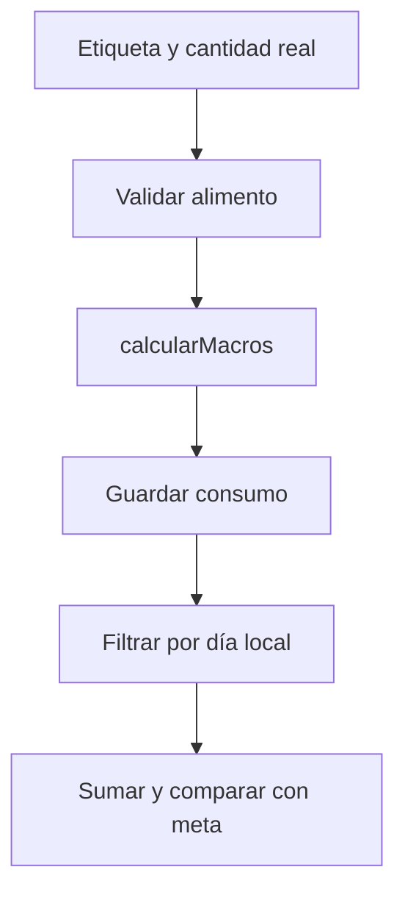

# Mateo Romani · Consumos y cálculo de macros

Responsabilidad de estudio y revisión de la edición 75; no es una declaración de autoría.

## Mapa mental

## Archivos y funciones

Pantalla: [Nutricion.jsx](../client/src/pages/Nutricion.jsx). Backend: [controllers/nutricion.controller.js](../controllers/nutricion.controller.js). Las rutas están en [usuarios.routes.js](../routes/usuarios.routes.js) y [gimnasio.routes.js](../routes/gimnasio.routes.js).

| Función | Qué hace y qué tenés que poder explicar |
| --- | --- |
| [calcularMacros](../controllers/nutricion.controller.js#L5) | Multiplica cada nutriente por cantidad/100 para g/ml o por cantidad para porciones, suma y redondea. |
| [datosComida](../controllers/nutricion.controller.js#L65) | Valida el nombre y tipo de comida y calcula sus nutrientes a partir de los alimentos. |
| [registrarComida](../controllers/nutricion.controller.js#L242) | Crea o edita un consumo propio con fecha válida y totales calculados en el servidor. |
| [verMacros](../controllers/nutricion.controller.js#L290) | Agrupa consumos por día en la zona de la cuenta, suma nutrientes y devuelve la dieta activa más reciente para comparar. |
| [eliminarConsumo](../controllers/nutricion.controller.js#L335) | Exige confirmación y elimina solamente un registro del usuario actual. |

## Librerías

React y Axios; Sequelize guarda ComidaConsumida con copia de alimentos y nutrientes. Intl convierte el instante a un día local. Las etiquetas nutricionales se ingresan manualmente, no se consultan a un proveedor externo.

## Qué entender

Por 100 g no es por porción. Ejemplo: 50 g de un alimento de 400 kcal/100 g son 200 kcal. No se aceptan totales inventados enviados por el navegador. Cambiar la dieta no debe modificar un consumo anterior. Diferenciá fecha UTC y fecha local.

Ubicá useState, useEffect cuando se use, los eventos del formulario y las llamadas Axios. Para cada función explicá entradas, validación, consulta y respuesta; no hace falta memorizar palabra por palabra.

## Recorrido de defensa

Ingresá 50 g de un alimento de 400 kcal/100 g y verificá 200 kcal. Cambiá la cantidad a 100 y revisá el total. Consultá otro día sin registros. Mostrá que no se agregan automáticamente las comidas del plan.

## Base común

Pantalla → ruta → controlador → modelo → MySQL. Las relaciones están en [models/index.js](../models/index.js). La confirmación está en [Confirmar.jsx](../client/src/components/Confirmar.jsx). Consultá el [alcance](../docs/ALCANCE.md). Vite solo inicia o compila React; no es una función del gimnasio ni hay que estudiar sus mecanismos internos.
