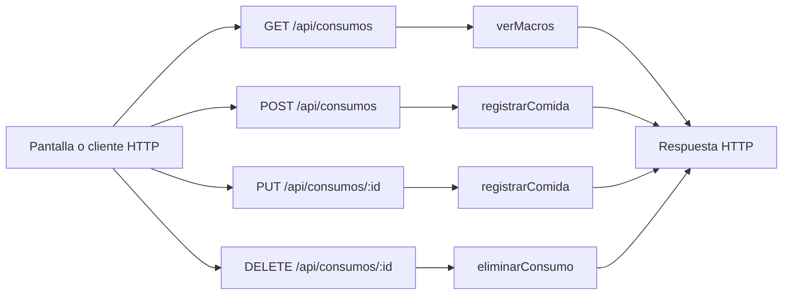

# Mateo Romani · endpoints de consumos y macros

Edición **75**. Tu responsabilidad principal son los **4 endpoints de la tabla siguiente**. Las funciones auxiliares y las consultas a rutas de otros compañeros se distinguen más abajo. Esto es un reparto para estudiar y defender, no una declaración de quién escribió el código.

## Tus endpoints concretos

| Método y ruta completa | Ruta en el código | Handler real | Acceso |
| --- | --- | --- | --- |
| `GET /api/consumos` | [routes/gimnasio.routes.js](../routes/gimnasio.routes.js#L31) | [verMacros](../controllers/nutricion.controller.js#L404) | Sesión requerida |
| `POST /api/consumos` | [routes/gimnasio.routes.js](../routes/gimnasio.routes.js#L32) | [registrarComida](../controllers/nutricion.controller.js#L340) | Sesión requerida |
| `PUT /api/consumos/:id` | [routes/gimnasio.routes.js](../routes/gimnasio.routes.js#L33) | [registrarComida](../controllers/nutricion.controller.js#L340) | Sesión requerida |
| `DELETE /api/consumos/:id` | [routes/gimnasio.routes.js](../routes/gimnasio.routes.js#L34) | [eliminarConsumo](../controllers/nutricion.controller.js#L472) | Sesión requerida |

Las URLs de esta tabla incluyen `/api`. En React vas a ver llamadas como `axios.get("/cuenta")`: [App.jsx](../client/src/App.jsx) configura `axios.defaults.baseURL = "/api"`. No existe una ruta extra por cada función interna.

## Mapa de tus endpoints

En los endpoints privados, `verificarSesion` corre antes del handler. Las tablas y consultas concretas se explican por endpoint; el catálogo usa JSON local y `/ia/estado` lee configuración, no hacen consultas de negocio a MySQL.

## Explicación de cada endpoint

### `GET /api/consumos`

**Qué recibe.** Query opcional: `fecha` YYYY-MM-DD. Si falta usa hoy en la zona horaria de la cuenta.

**Qué ejecuta y consulta.** Lee `ComidaConsumida` propia, filtra cada instante por su día local, suma macros y consulta la `Dieta` activa más reciente para comparar metas.

**Qué valida o decide.** Una fecha ISO inválida devuelve error. El consumo real y el plan no se suman entre sí. Este endpoint calcula totales; no escribe registros.

**Respuesta correcta.** `200` → `{fecha, items, totales: {calorias, proteinas_g, carbohidratos_g, grasas_g}, dieta}`; dieta puede ser null.

**Errores propios.** `400` fecha inválida; `500` si no puede consultar/calcular.

**Quién lo llama.** Nutricion.jsx modo consumos: `cargar` cuando cambia fecha.

**Cómo mostrarlo.** Consultar un día vacío y otro con consumo; explicar cómo 02:30 UTC puede pertenecer al día anterior en Buenos Aires.

### `POST /api/consumos`

**Qué recibe.** Body: `nombre_comida`, `tipo_comida`, `fecha_consumo` como instante ISO y `alimentos` (1–30). Cada alimento incluye nombre, cantidad, unidad g/ml/porcion y sus calorías/proteínas/carbohidratos/grasas por 100 g/ml o una porción.

**Qué ejecuta y consulta.** `datosComida` llama a `calcularMacros`; crea una fila `ComidaConsumida` con propietario, instante, copia de alimentos y totales.

**Qué valida o decide.** Fecha válida desde el año 2000 y no futura. Se recalculan totales en el servidor; un total enviado aparte por el cliente no reemplaza este cálculo. Cantidades positivas y nutrientes válidos.

**Respuesta correcta.** `201` → consumo creado con `calorias_totales`, `proteinas_totales_g`, `carbohidratos_totales_g`, `grasas_totales_g`.

**Errores propios.** `400` por alimento, cantidad o fecha inválidos; `500` si falla.

**Quién lo llama.** Nutricion.jsx modo consumos: `guardar` sin id editando; vacío en fecha/hora del formulario se convierte al instante actual antes de enviar.

**Cómo mostrarlo.** Ingresar 50 g de un alimento de 400 kcal/100 g y comprobar que registra 200 kcal.

### `PUT /api/consumos/:id`

**Qué recibe.** URL `id` + body completo del POST /api/consumos.

**Qué ejecuta y consulta.** Recalcula macros, busca `ComidaConsumida` propia por id y actualiza su copia de alimentos, fecha y totales.

**Qué valida o decide.** Fecha válida desde el año 2000 y no futura. Se recalculan totales en el servidor; un total enviado aparte por el cliente no reemplaza este cálculo. Cantidades positivas y nutrientes válidos. Editar un consumo es corregir lo registrado, no cambiar una comida del plan.

**Respuesta correcta.** `200` → consumo actualizado.

**Errores propios.** `400` datos inválidos; `404` consumo ajeno/inexistente; `500` por fallo.

**Quién lo llama.** Nutricion.jsx modo consumos: `editar` llena datos y `guardar` usa PUT.

**Cómo mostrarlo.** Cambiar la cantidad de 50 a 100 g y comprobar que el total cambia de 200 a 400 kcal.

### `DELETE /api/consumos/:id`

**Qué recibe.** URL `id`; body `confirmar: true`.

**Qué ejecuta y consulta.** Busca `ComidaConsumida` propia y ejecuta `destroy`.

**Qué valida o decide.** Es borrado de un consumo concreto; a diferencia de la dieta no se marca un estado de baja.

**Respuesta correcta.** `204` sin JSON.

**Errores propios.** `400` sin confirmar; `404` consumo ajeno/inexistente; `500` por fallo.

**Quién lo llama.** Nutricion.jsx modo consumos: `eliminar`; Axios manda el body de DELETE en `data`.

**Cómo mostrarlo.** Eliminar solo un consumo sintético y explicar por qué disminuye el total diario.

## Funciones de apoyo: no son otros endpoints

Conocé para qué sirven cuando aparecen en el recorrido de tus rutas. No se asigna una ruta inexistente ni se cambia el responsable por compartir una función.

| Función auxiliar | Para qué interviene |
| --- | --- |
| [datosComida](../controllers/nutricion.controller.js#L79) | Valida nombre/tipo y obtiene nutrientes calculados. |
| [calcularMacros](../controllers/nutricion.controller.js#L4) | Suma nutrientes proporcionales a la cantidad, con redondeo. |

## Archivos que tenés que ubicar

- [controllers/nutricion.controller.js](../controllers/nutricion.controller.js): handlers y lógica de tus endpoints.
- [client/src/pages/Nutricion.jsx](../client/src/pages/Nutricion.jsx): estado, formulario o carga que llama a esas rutas.
- [models/index.js](../models/index.js): relaciones; seguí desde ahí solo los modelos usados en tus consultas.
- [auth.controller.js](../controllers/auth.controller.js#L5): antes de un handler privado comprueba cookie, JWT, sesión persistida y cuenta activa; deja el usuario en `req.user`.

## Lo mínimo común para defender estas rutas

Diferenciá `req.params` (id en la URL), `req.query` (filtros después de `?`), `req.body` (JSON enviado) y `req.user` (cuenta autenticada). El usuario propietario se toma de la sesión, no de un id arbitrario enviado por el formulario.

Todos los endpoints privados pueden responder `401` si la sesión falta, vence, se cierra o la cuenta no está habilitada; el middleware puede responder `500` si falla su comprobación. No confundas estos errores compartidos con los que devuelve el handler. El parser general también puede rechazar JSON inválido (`400`) o un body demasiado grande (`413`).

Para respuestas `204`, no hay JSON que leer. Para crear suele usarse `201`; para leer/editar, `200`. En Axios, el JSON está en `respuesta.data`; en DELETE, el body se pasa como `{data: {...}}`.

No hace falta estudiar todo el sistema ni el funcionamiento interno de Vite. Sí poder seguir tu request desde la pantalla hasta las consultas y explicar una respuesta de éxito y una condición de error.

## Librerías que intervienen

Express y Sequelize guardan/consultan consumo. Intl resuelve el día local; Math redondea totales. React y Axios manejan fecha, formulario y balance. Los valores nutricionales son ingresados manualmente.

## Coordinación con otros responsables

- Si necesitás datos de otra funcionalidad, consultá el índice general. Un `findAll` interno de tu controlador no equivale a llamar por HTTP a otro endpoint.

Consultá el [reparto completo](README.md) y el [alcance](../docs/ALCANCE.md) antes de prometer una ruta de otra entrega.

## Cómo leer el código simplificado

El recorrido sigue siendo pantalla React → ruta Express → controlador → modelo Sequelize → MySQL. No hay una capa de servicios. Las decisiones de negocio usan `if`/`else` y los recorridos usan `for (let i = 0; i < lista.length; i++)`. En cada vuelta, `lista[i]` es el elemento de esa posición; el nombre de la lista no tiene significado especial para JavaScript.

Se quitaron `for...of`, `?.`, `??` y `...` del código de controladores y pantallas. Los controladores ya no usan callbacks de `map`, `filter`, `find` o `some` ni comparadores de `sort`: las búsquedas, validaciones y cálculos están desplegados en bucles. En los formularios se construye una copia con los campos explícitos antes de llamar al setter de React; `slice()` copia una lista y `push()` agrega un elemento. No hay que modificar directamente el estado anterior.

En JSX se mantiene `map` únicamente para dibujar listas de elementos. Por ejemplo, `items.map((rutina) => <...>)` produce un bloque visual por rutina; no guarda datos ni llama a MySQL. `key` identifica cada fila para React. Algunas etiquetas usan un condicional sencillo `condicion ? textoSi : textoNo`; la validación del servidor está escrita con `if`. Las funciones de evento con `=>` y la desestructuración también aparecen en los ejemplos del curso: no son otra arquitectura.

No se afirma que todo el proyecto sea idéntico al repaso. El sistema tiene más funciones que un CRUD de ejemplo. Las protecciones conservadas se explican abajo según tu recorrido. [Criterio y diferencias conservadas](../docs/CRITERIO-DEL-PROFESOR.md).

### Tu recorrido, paso a paso

`calcularMacros` recorre alimentos y nutrientes con dos bucles tradicionales. Valida cantidad y unidad. Para gramos o mililitros calcula `nutriente * cantidad / 100`; para porciones divide por 1. Suma cada nutriente y al final redondea calorías a entero y macros a dos decimales. El servidor recalcula; no confía en un total enviado por el navegador.

En React, `copiarAlimento` y `copiarComida` enumeran campos. `cambiarAlimento` copia una lista con `slice`, modifica la copia elegida y llama a `cambiarComida`. `quitarAlimento` y `quitarComida` recorren y conservan los elementos restantes. `agregarAlimento` y `agregarComida` copian y agregan con `push`. `actualizarComidas` reúne los campos de la dieta para actualizar su estado. `map` solo dibuja los campos y registros.

`registrarComida` guarda lo consumido. `verMacros` recorre los consumos, conserva los del día local del usuario y suma los nutrientes. La dieta vigente se devuelve como referencia, no como consumo.
