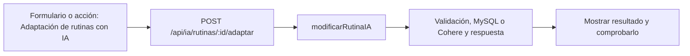

# Joaquín Casanou · próximo avance

**Tarea nueva:** Adaptación de rutinas con IA.

**Estado: pendiente de trabajo y verificación individual.** No es una declaración de que ya lo programaste. Se conserva tu responsabilidad de base del 50 % y se añade un recorrido concreto del incremento.

## Qué tenés que hacer ahora

Elegir una rutina existente, enviar contexto previo y adaptar conservando su id. Revisar el flujo común con Tomás; demostrar diferencias entre crear una rutina nueva y reemplazar una anterior.

## Mapa de tu avance

## Tus endpoints y continuidad

| Etapa | Método y ruta | Handler real |
| --- | --- | --- |
| Base del 50 % | `GET /api/ejercicios` | [listarEjercicios](../controllers/rutinas.controller.js#L367) |
| Base del 50 % | `GET /api/rutinas` | [listarRutinas](../controllers/rutinas.controller.js#L177) |
| Avance nuevo | `POST /api/ia/rutinas/:id/adaptar` | [modificarRutinaIA](../controllers/ia.controller.js#L261) |

## Funciones concretas del avance

| Función | Qué parte recorrés |
| --- | --- |
| [modificarRutinaIA](../controllers/ia.controller.js#L261) | Entrada de adaptación; delega al flujo con el id existente. |
| [generarRutinaIA](../controllers/ia.controller.js#L88) | Tu tramo aporta rutina previa y comprueba propiedad; conserva el id al reemplazar ejercicios. |
| [generarRutina](../controllers/ia.controller.js#L52) | Formato de propuesta compartido con Tomás. |
| [generar](../client/src/pages/Asistente.jsx#L101) | Selector de rutina y llamada /adaptar; preparar/confirmar el envío. |

Los helpers son funciones internas, no endpoints adicionales. Si una función sirve a POST y PUT o a generación y adaptación, se revisa entre los dos responsables. No hay que duplicarla ni separarla artificialmente para aparentar más código.

## Entradas, consultas y respuestas de tus rutas

### `GET /api/ejercicios`

**Qué recibe.** Query opcional: `buscar`, `grupo`, `pagina` (desde 1). Sin body.

**Qué ejecuta y consulta.** Carga el JSON local de `models/exercises/exercises.json`; filtra nombre/body_part, arma grupos y corta de a 24. No consulta MySQL para el catálogo; la autenticación sí consultó la sesión.

**Qué valida o decide.** Búsqueda de nombre/grupo en inglés sin distinguir mayúsculas; `grupo` filtra coincidencia exacta. Página limitada a 1–1000. No descarga GIF ni llama una API externa.

**Respuesta correcta.** `200` → `{items, total, pagina, grupos}`.

**Errores propios.** No tiene un error de negocio explícito; aplican autenticación y el error general del servidor si algo inesperado falla.

**Quién lo llama.** Rutinas.jsx: `buscar`, botones de paginación y `agregarFicha`.

**Cómo mostrarlo.** Buscar squat, abrir instrucciones, paginar y agregar una ficha al editor; todavía hay que guardar la rutina.

### `GET /api/rutinas`

**Qué recibe.** Sin body.

**Qué ejecuta y consulta.** `Rutina.findAll` por usuario y estado distinto de eliminada, con `include` de `RutinaEjercicio`. El `order` de Sequelize pide a MySQL rutinas por fecha y ejercicios por día/posición. Un bucle tradicional convierte cada rutina a JSON y normaliza el día a número; ya no hay comparador `sort`.

**Qué valida o decide.** No hay un `GET /rutinas/:id`: este listado ya trae los detalles y la interfaz muestra cada rutina.

**Respuesta correcta.** `200` → `{items: [...]}` con `ejercicios` dentro de cada plan.

**Errores propios.** `500` si no puede consultar.

**Quién lo llama.** Rutinas.jsx: `cargar`; Entrenamientos.jsx lo usa como selector. En el 75 también Asistente.jsx lo consulta para elegir un plan a adaptar.

**Cómo mostrarlo.** Mostrar una rutina completa desde el listado y explicar el include y la ordenación.

### `POST /api/ia/rutinas/:id/adaptar`

**Qué recibe.** Body: `preferencias` de 3–1000 caracteres y `confirmar: true`. Para adaptar, además `id` en la URL.

**Qué ejecuta y consulta.** Busca última `MedicionFisica`, `Objetivo` activo y últimos cinco `Entrenamiento` completos. Pide a Cohere un JSON de plan, valida ejercicios y vuelve a comprobar cuenta/consentimiento/objetivo. `guardarRutina` persiste cabecera y detalles en una transacción. Además busca `Rutina` propia activa con sus ejercicios para el contexto anterior. El handler delega en `generarRutinaIA` usando ese id.

**Qué valida o decide.** Conserva el id del plan y reemplaza su contenido; los entrenamientos históricos no se reescriben. Requiere confirmar el envío y reemplazo.

**Respuesta correcta.** `200` → `{rutina, message}` con el mismo id.

**Errores propios.** `400` por entradas inválidas; `403` sin consentimiento; `404` plan ajeno/inexistente/inactivo; `409` si faltan datos; `503` si falla proveedor/validación/guardado.

**Quién lo llama.** Asistente.jsx: `generar` con una rutina elegida para adaptar.

**Cómo mostrarlo.** Adaptar una rutina de prueba y mostrar el mismo id con ejercicios distintos; contrastar con crear otra rutina.

## Cuándo está terminado tu bloque

- [ ] Adaptar conserva el id de la rutina.
- [ ] El nuevo contenido responde a preferencias y pasa validarEjercicios.
- [ ] Una rutina ajena o no activa se rechaza; sin propuesta válida no hay reemplazo parcial.
- [ ] Explicar el recorrido desde el input hasta la respuesta, sin leer el código palabra por palabra.
- [ ] Registrar qué revisión, cambio o comprobación hiciste realmente; si hay commit, usar la identidad real.

## Tamaño previsto y trabajo compartido

Como referencia, este paquete cubre **9.46 %** de las 1.702 líneas nuevas/reemplazadas del incremento medido. Es cobertura asignada para revisar/trabajar, no un porcentaje de programación ya hecho. No mide dificultad ni tiempo y se reajusta si al trabajar aparece una diferencia de carga.

[Plan y límites del cálculo](../docs/PLAN.md). La meta es cerca de 11 % por persona, con margen; el alcance de entrega puede quedar por encima o por debajo del nombre histórico 75. No se inflan líneas ni se atribuye código intacto como una mejora.

## Lectura del código

Pantalla React → ruta Express → controlador → Sequelize → MySQL. req.params trae el id; req.query, filtros; req.body, JSON; req.user, la cuenta autenticada. Las consultas deben restringir el propietario. Axios envía pedidos desde React y el JSON recibido está en respuesta.data. Un 204 no tiene JSON.

El backend usa for tradicional, if/else, async/await y try/catch. En JSX, map dibuja listas. Las transacciones con commit/rollback evitan guardados parciales; el cifrado, hash y sesión conservan cuentas y datos existentes. La clave de Cohere permanece en el servidor. No se reintroducen los temas retirados ni capas de servicios.

[Criterio del profesor y diferencias conservadas](../docs/CRITERIO-DEL-PROFESOR.md).
