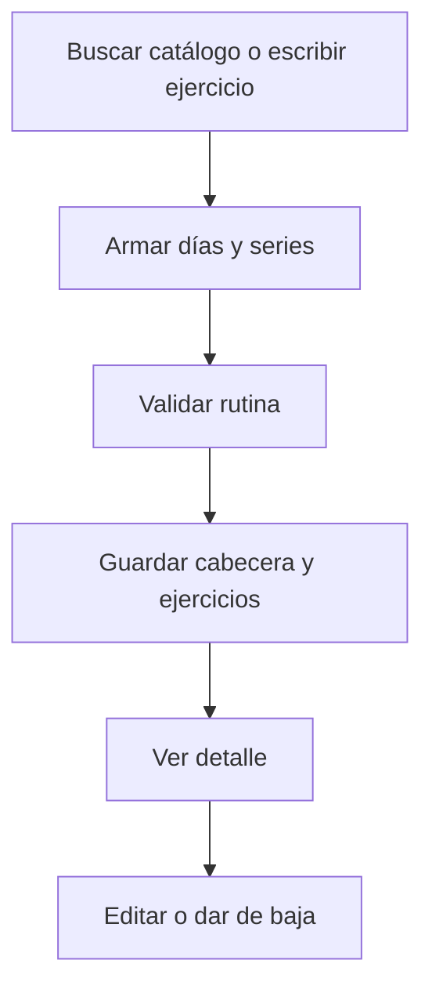

# Joaquín Casanou · Rutinas manuales y catálogo de ejercicios

Responsabilidad de estudio y revisión de la edición 75; no es una declaración de autoría.

## Mapa mental

## Archivos y funciones

Pantalla: [Rutinas.jsx](../client/src/pages/Rutinas.jsx). Backend: [controllers/rutinas.controller.js](../controllers/rutinas.controller.js). Las rutas están en [usuarios.routes.js](../routes/usuarios.routes.js) y [gimnasio.routes.js](../routes/gimnasio.routes.js).

| Función | Qué hace y qué tenés que poder explicar |
| --- | --- |
| [listarEjercicios](../controllers/rutinas.controller.js#L215) | Busca por nombre/grupo, pagina de a 24 y devuelve instrucciones del catálogo textual. |
| [validarEjercicios](../controllers/rutinas.controller.js#L11) | Valida días, orden, series, repeticiones, cargas y descansos; toma el nombre del catálogo cuando hay id. |
| [listarRutinas](../controllers/rutinas.controller.js#L105) | Carga planes propios con sus ejercicios ordenados y normaliza el día para el editor. |
| [actualizarRutina](../controllers/rutinas.controller.js#L124) | Valida la cabecera y objetivo, luego crea o edita el plan en una transacción. |
| [guardarRutina](../controllers/rutinas.controller.js#L89) | Persiste cabecera y lista de ejercicios; también lo usa la generación IA ya validada. |
| [agregarEjercicio](../controllers/rutinas.controller.js#L78) | Inserta una fila vinculada a la rutina. |
| [eliminarEjercicio](../controllers/rutinas.controller.js#L81) | Elimina los detalles de un plan durante su reemplazo. |
| [actualizarRutinaEjercicio](../controllers/rutinas.controller.js#L84) | Reemplaza los ejercicios dentro de la misma transacción. |
| [eliminarRutina](../controllers/rutinas.controller.js#L185) | Da de baja una rutina salvo que tenga un entrenamiento abierto. |

## Librerías

React y Axios; Sequelize para Rutina/RutinaEjercicio/Objetivo; catálogo JSON de exercises-dataset con licencia conservada. No requiere imágenes ni llamadas externas para buscar ejercicios.

## Qué entender

Día lunes=1 a domingo=7; orden distinto dentro del mismo día; peso cero es peso corporal. El catálogo fija nombre y grupo desde el servidor. Una edición no borra entrenamientos, porque éstos ya copiaron los datos. No se puede dar de baja un plan mientras se está entrenando.

Ubicá useState, useEffect cuando se use, los eventos del formulario y las llamadas Axios. Para cada función explicá entradas, validación, consulta y respuesta; no hace falta memorizar palabra por palabra.

## Recorrido de defensa

Buscá squat, leé las instrucciones, agregá una ficha al editor y quitá el ejercicio vacío inicial si corresponde. Guardá, editá series y volvé a guardar. Mostrá una rutina manual y diferenciála de una propuesta IA.

## Base común

Pantalla → ruta → controlador → modelo → MySQL. Las relaciones están en [models/index.js](../models/index.js). La confirmación está en [Confirmar.jsx](../client/src/components/Confirmar.jsx). Consultá el [alcance](../docs/ALCANCE.md). Vite solo inicia o compila React; no es una función del gimnasio ni hay que estudiar sus mecanismos internos.
