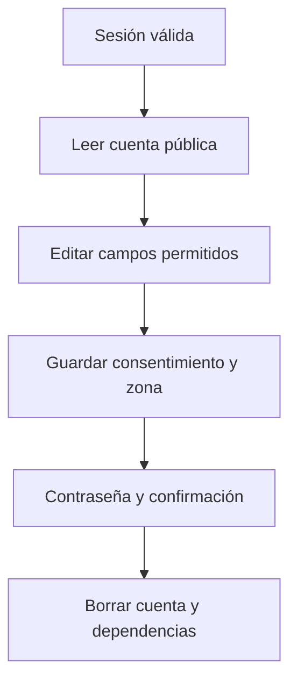

# Simón Castellani · Mi cuenta, privacidad y eliminación

Responsabilidad de estudio y revisión de la edición 75; no es una declaración de autoría.

## Mapa mental

## Archivos y funciones

Pantalla: [Cuenta.jsx](../client/src/pages/Cuenta.jsx). Backend: [controllers/usuarios.controller.js](../controllers/usuarios.controller.js). Las rutas están en [usuarios.routes.js](../routes/usuarios.routes.js) y [gimnasio.routes.js](../routes/gimnasio.routes.js).

| Función | Qué hace y qué tenés que poder explicar |
| --- | --- |
| [verCuenta](../controllers/usuarios.controller.js#L167) | Devuelve los campos públicos del usuario autenticado. |
| [datosPublicos](../controllers/usuarios.controller.js#L14) | Selecciona qué campos llegan al cliente y descifra el teléfono, sin incluir hash ni token. |
| [actualizarDatos](../controllers/usuarios.controller.js#L171) | Valida nombre, teléfono, fecha, género, zona horaria y consentimiento; guarda solo campos permitidos. |
| [eliminarCuenta](../controllers/usuarios.controller.js#L228) | Exige contraseña y confirmación; borra cuenta y dependencias en una transacción. |
| [encriptarRreversible](../controllers/seguridad.controller.js#L10) | Cifra el teléfono con una clave privada y un IV nuevo. |
| [desencriptar](../controllers/seguridad.controller.js#L31) | Recupera el teléfono y verifica su autenticidad. |

## Librerías

React y Axios; bcrypt compara la contraseña para borrar; crypto de Node cifra/descifra el teléfono con AES-GCM; Sequelize y claves foráneas eliminan datos relacionados. La clave privada de cifrado está fuera del repositorio.

## Qué entender

Autenticación no es autorización: saber quién sos no permite ver registros de otro. Cada consulta usa usuario_id de la sesión, no del formulario. Teléfono debe recuperarse para mostrarse; la contraseña solo se compara como hash. Retirar consentimiento bloquea futuras llamadas IA, no borra el historial automáticamente.

Ubicá useState, useEffect cuando se use, los eventos del formulario y las llamadas Axios. Para cada función explicá entradas, validación, consulta y respuesta; no hace falta memorizar palabra por palabra.

## Recorrido de defensa

Cambiá un dato del perfil y guardá. Activá/desactivá consentimiento para mostrar el efecto en IA. Abrí la confirmación de eliminación y cancelala: no borres una cuenta de una persona durante la exposición.

## Base común

Pantalla → ruta → controlador → modelo → MySQL. Las relaciones están en [models/index.js](../models/index.js). La confirmación está en [Confirmar.jsx](../client/src/components/Confirmar.jsx). Consultá el [alcance](../docs/ALCANCE.md). Vite solo inicia o compila React; no es una función del gimnasio ni hay que estudiar sus mecanismos internos.
