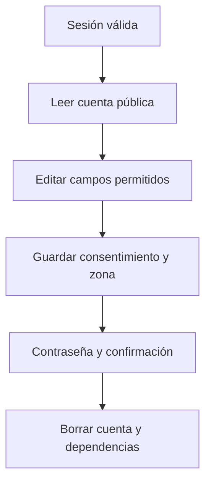

# Simón Castellani · Mi cuenta, privacidad y eliminación

Esta es tu responsabilidad de estudio y revisión. No declara quién escribió el código.

## Mapa mental

## Archivos y funciones

Pantalla: [client/src/pages/Cuenta.jsx](../client/src/pages/Cuenta.jsx). Backend: [controllers/usuarios.controller.js](../controllers/usuarios.controller.js). Rutas de cuentas en [usuarios.routes.js](../routes/usuarios.routes.js); las demás en [gimnasio.routes.js](../routes/gimnasio.routes.js).

| Función | Qué hace y qué tenés que poder explicar |
| --- | --- |
| [verCuenta](../controllers/usuarios.controller.js#L171) | Devuelve los campos públicos del usuario autenticado. |
| [datosPublicos](../controllers/usuarios.controller.js#L16) | Selecciona qué campos llegan al cliente y descifra el teléfono, sin incluir hash ni token. |
| [actualizarDatos](../controllers/usuarios.controller.js#L175) | Valida nombre, teléfono, fecha, género, zona horaria y consentimiento; guarda solo campos permitidos. |
| [eliminarCuenta](../controllers/usuarios.controller.js#L232) | Exige contraseña y confirmación; borra cuenta y dependencias en una transacción. |
| [encriptarRreversible](../controllers/seguridad.controller.js#L10) | Cifra el teléfono con una clave privada y un IV distinto por operación. |
| [desencriptar](../controllers/seguridad.controller.js#L31) | Recupera el teléfono y comprueba su autenticidad. |

## Librerías que intervienen

React y Axios; bcrypt compara la contraseña para borrar; crypto de Node cifra/descifra el teléfono con AES-GCM; Sequelize y claves foráneas eliminan datos relacionados. La clave privada de cifrado está fuera del repositorio.

## Qué tenés que entender

Autenticación no es autorización: saber quién sos no permite ver registros de otro. Cada consulta usa usuario_id de la sesión, no del formulario. Teléfono debe recuperarse para mostrarse; la contraseña solo se compara como hash. Retirar consentimiento bloquea futuras llamadas IA, no borra el historial automáticamente.

En la pantalla ubicá los estados (useState), la carga inicial (useEffect), el submit y las llamadas Axios. Seguí la ruta hasta la función del controlador y el modelo. Entendé qué datos entran, qué se valida, qué consulta se ejecuta y qué respuesta se devuelve. No hace falta memorizar cada palabra, pero sí poder explicar una función y una condición de error.

## Recorrido para defenderlo

Cambiá un dato del perfil y guardá. Activá/desactivá consentimiento para mostrar el efecto en IA. Abrí la confirmación de eliminación y cancelala: no borres una cuenta de una persona durante la exposición.

## Base común mínima

Todos deben poder explicar `pantalla → ruta → controlador → modelo → MySQL`, request/response, async/await y try/catch. Las relaciones están en [models/index.js](../models/index.js). La confirmación visible está en [Confirmar.jsx](../client/src/components/Confirmar.jsx): muestra aceptar/cancelar; el servidor vuelve a exigir confirmación. Consultá [el alcance](../docs/ALCANCE.md) antes de prometer funciones del sistema completo.
