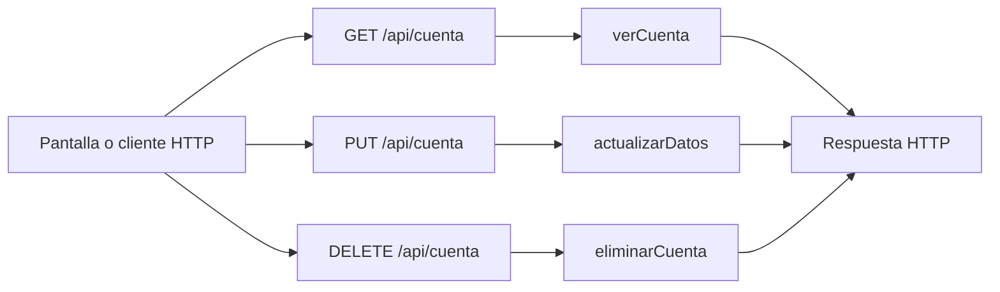

# Simón Castellani · endpoints de mi cuenta y datos personales

Edición **75**. Tu responsabilidad principal son los **3 endpoints de la tabla siguiente**. Las funciones auxiliares y las consultas a rutas de otros compañeros se distinguen más abajo. Esto es un reparto para estudiar y defender, no una declaración de quién escribió el código.

## Tus endpoints concretos

| Método y ruta completa | Ruta en el código | Handler real | Acceso |
| --- | --- | --- | --- |
| `GET /api/cuenta` | [routes/usuarios.routes.js](../routes/usuarios.routes.js#L7) | [verCuenta](../controllers/usuarios.controller.js#L233) | Sesión requerida |
| `PUT /api/cuenta` | [routes/usuarios.routes.js](../routes/usuarios.routes.js#L8) | [actualizarDatos](../controllers/usuarios.controller.js#L238) | Sesión requerida |
| `DELETE /api/cuenta` | [routes/usuarios.routes.js](../routes/usuarios.routes.js#L9) | [eliminarCuenta](../controllers/usuarios.controller.js#L306) | Sesión requerida |

Las URLs de esta tabla incluyen `/api`. En React vas a ver llamadas como `axios.get("/cuenta")`: [App.jsx](../client/src/App.jsx) configura `axios.defaults.baseURL = "/api"`. No existe una ruta extra por cada función interna.

## Mapa de tus endpoints

En los endpoints privados, `verificarSesion` corre antes del handler. Las tablas y consultas concretas se explican por endpoint; el catálogo usa JSON local y `/ia/estado` lee configuración, no hacen consultas de negocio a MySQL.

## Explicación de cada endpoint

### `GET /api/cuenta`

**Qué recibe.** Sin body. La identidad sale de la cookie, no de un id elegido en la URL.

**Qué ejecuta y consulta.** La consulta ya la hizo `verificarSesion`: `Sesion.findOne` y `Usuario.findByPk`. `verCuenta` solo devuelve `datosPublicos(req.user)`.

**Qué valida o decide.** Distinguir la consulta del middleware de esta función, que no vuelve a consultar la tabla.

**Respuesta correcta.** `200` → `{user: {id, nombre, apellido, email, telefono, genero, fecha_nacimiento, zona_horaria, consentimiento_ia}}`.

**Errores propios.** El handler no tiene errores propios; los errores de autenticación los devuelve el middleware.

**Quién lo llama.** App.jsx: comprobación inicial `axios.get("/cuenta")`; los datos pasan como props a Cuenta.jsx.

**Cómo mostrarlo.** Recargar con sesión activa y explicar por qué permanece el usuario conectado.

### `PUT /api/cuenta`

**Qué recibe.** Body: `nombre`, `apellido`, `telefono`, `genero`, `zona_horaria`, `consentimiento_ia` booleano; `fecha_nacimiento` opcional. El formulario envía el perfil completo.

**Qué ejecuta y consulta.** Actualiza el `Usuario` cargado por la sesión y crea un evento en `Bitacora`. Cifra el teléfono antes de guardarlo.

**Qué valida o decide.** Nombre y longitudes válidas; género masculino/femenino/otro; fecha de nacimiento real y no futura; zona horaria reconocida. No permite cambiar correo, rol o hash por enviar campos extra.

**Respuesta correcta.** `200` → `{user: ...}` actualizado.

**Errores propios.** `400` por datos/fecha/zona inválidos; `500` si no puede guardar.

**Quién lo llama.** Cuenta.jsx: `guardar` → `axios.put("/cuenta", datos)`.

**Cómo mostrarlo.** Cambiar nombre o consentimiento, guardar y recargar para comprobar persistencia.

### `DELETE /api/cuenta`

**Qué recibe.** Body JSON: `password` actual y `confirmar: true`. Axios lo envía en `{data: {...}}`, no como query.

**Qué ejecuta y consulta.** Compara bcrypt. En una transacción registra un evento sin actor y destruye `req.user`; las claves foráneas borran dependencias o dejan el actor de la bitácora en NULL. Limpia la cookie.

**Qué valida o decide.** Debe ser la cuenta de la sesión y su contraseña correcta. Es un borrado definitivo, no una baja de rutina.

**Respuesta correcta.** `204` sin JSON.

**Errores propios.** `403` si falta confirmar o la contraseña no coincide; `500` si falla la eliminación.

**Quién lo llama.** Cuenta.jsx: `eliminar` y confirmación visible.

**Cómo mostrarlo.** Abrir y cancelar la confirmación. Para probar el borrado, usar solamente una cuenta sintética propia y descartable.

## Funciones de apoyo: no son otros endpoints

Conocé para qué sirven cuando aparecen en el recorrido de tus rutas. No se asigna una ruta inexistente ni se cambia el responsable por compartir una función.

| Función auxiliar | Para qué interviene |
| --- | --- |
| [datosPublicos](../controllers/usuarios.controller.js#L13) | Selecciona los campos de la respuesta; no es un endpoint. |
| [compararPassword](../controllers/seguridad.controller.js#L4) | Compara una contraseña contra el hash. |
| [encriptarRreversible](../controllers/seguridad.controller.js#L8) | Cifra el teléfono. |
| [desencriptar](../controllers/seguridad.controller.js#L30) | Recupera el teléfono para mostrarlo. |

## Archivos que tenés que ubicar

- [controllers/usuarios.controller.js](../controllers/usuarios.controller.js): handlers y lógica de tus endpoints.
- [client/src/App.jsx](../client/src/App.jsx): estado, formulario o carga que llama a esas rutas.
- [client/src/pages/Cuenta.jsx](../client/src/pages/Cuenta.jsx): estado, formulario o carga que llama a esas rutas.
- [models/index.js](../models/index.js): relaciones; seguí desde ahí solo los modelos usados en tus consultas.
- [auth.controller.js](../controllers/auth.controller.js#L5): antes de un handler privado comprueba cookie, JWT, sesión persistida y cuenta activa; deja el usuario en `req.user`.

## Lo mínimo común para defender estas rutas

Diferenciá `req.params` (id en la URL), `req.query` (filtros después de `?`), `req.body` (JSON enviado) y `req.user` (cuenta autenticada). El usuario propietario se toma de la sesión, no de un id arbitrario enviado por el formulario.

Todos los endpoints privados pueden responder `401` si la sesión falta, vence, se cierra o la cuenta no está habilitada; el middleware puede responder `500` si falla su comprobación. No confundas estos errores compartidos con los que devuelve el handler. El parser general también puede rechazar JSON inválido (`400`) o un body demasiado grande (`413`).

Para respuestas `204`, no hay JSON que leer. Para crear suele usarse `201`; para leer/editar, `200`. En Axios, el JSON está en `respuesta.data`; en DELETE, el body se pasa como `{data: {...}}`.

No hace falta estudiar todo el sistema ni el funcionamiento interno de Vite. Sí poder seguir tu request desde la pantalla hasta las consultas y explicar una respuesta de éxito y una condición de error.

## Librerías que intervienen

Express y Sequelize leen/actualizan la cuenta; bcrypt comprueba la contraseña al borrar. crypto de Node cifra/descifra el teléfono mediante los helpers. React y Axios envían el perfil; React Router vuelve al inicio cuando se elimina la cuenta.

## Coordinación con otros responsables

- `POST /api/logout`: responsable **Gianluca Pizarro**. Entendé qué recibe y devuelve; no se vuelve a asignar como endpoint tuyo.

Consultá el [reparto completo](README.md) y el [alcance](../docs/ALCANCE.md) antes de prometer una ruta de otra entrega.

## Cómo leer el código simplificado

El recorrido sigue siendo pantalla React → ruta Express → controlador → modelo Sequelize → MySQL. No hay una capa de servicios. Las decisiones de negocio usan `if`/`else` y los recorridos usan `for (let i = 0; i < lista.length; i++)`. En cada vuelta, `lista[i]` es el elemento de esa posición; el nombre de la lista no tiene significado especial para JavaScript.

Se quitaron `for...of`, `?.`, `??` y `...` del código de controladores y pantallas. Los controladores ya no usan callbacks de `map`, `filter`, `find` o `some` ni comparadores de `sort`: las búsquedas, validaciones y cálculos están desplegados en bucles. En los formularios se construye una copia con los campos explícitos antes de llamar al setter de React; `slice()` copia una lista y `push()` agrega un elemento. No hay que modificar directamente el estado anterior.

En JSX se mantiene `map` únicamente para dibujar listas de elementos. Por ejemplo, `items.map((rutina) => <...>)` produce un bloque visual por rutina; no guarda datos ni llama a MySQL. `key` identifica cada fila para React. Algunas etiquetas usan un condicional sencillo `condicion ? textoSi : textoNo`; la validación del servidor está escrita con `if`. Las funciones de evento con `=>` y la desestructuración también aparecen en los ejemplos del curso: no son otra arquitectura.

No se afirma que todo el proyecto sea idéntico al repaso. El sistema tiene más funciones que un CRUD de ejemplo. Las protecciones conservadas se explican abajo según tu recorrido. [Criterio y diferencias conservadas](../docs/CRITERIO-DEL-PROFESOR.md).

### Tu recorrido, paso a paso

`verCuenta` prepara datos públicos sin devolver el hash de contraseña. `actualizarDatos` valida el perfil y cifra el teléfono antes de guardar. `eliminarCuenta` verifica la contraseña y la confirmación; elimina los datos relacionados dentro de una transacción y limpia la cookie.

En React, `cambiar` crea `nuevosDatos` con campos explícitos, toma el nombre del input y usa `if` para distinguir checkbox de texto. Después llama a `setDatos`; no modifica directamente el objeto anterior. Las llamadas a guardar y eliminar tienen sus propios `try/catch`.

La parte adicional que sí tenés que conocer es la diferencia entre hash y cifrado: bcrypt comprueba contraseñas sin recuperarlas; AES permite recuperar el teléfono con la clave del servidor. `encriptarRreversible` y `desencriptar` están aisladas en seguridad.controller.js. Se conservó AES para no exponer teléfonos ni volver ilegibles los datos existentes. No necesitás estudiar la matemática del algoritmo, pero sí sus entradas, salidas y dónde se mantiene la clave.
