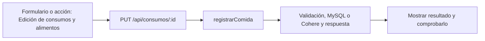

# Simón Castellani · próximo avance

**Tarea nueva:** Edición de consumos y alimentos.

**Estado: pendiente de trabajo y verificación individual.** No es una declaración de que ya lo programaste. Se conserva tu responsabilidad de base del 50 % y se añade un recorrido concreto del incremento.

## Qué tenés que hacer ahora

Abrir un consumo existente, editar alimento/cantidad/fecha y guardar por PUT. Editar o quitar alimentos sin perder otros campos; revisar las copias con Paulo. Comprobar que cambia el total del día y se mantiene el id.

## Mapa de tu avance

## Tus endpoints y continuidad

| Etapa | Método y ruta | Handler real |
| --- | --- | --- |
| Base del 50 % | `GET /api/cuenta` | [verCuenta](../controllers/usuarios.controller.js#L233) |
| Base del 50 % | `PUT /api/cuenta` | [actualizarDatos](../controllers/usuarios.controller.js#L238) |
| Base del 50 % | `DELETE /api/cuenta` | [eliminarCuenta](../controllers/usuarios.controller.js#L306) |
| Avance nuevo | `PUT /api/consumos/:id` | [registrarComida](../controllers/nutricion.controller.js#L340) |

## Funciones concretas del avance

| Función | Qué parte recorrés |
| --- | --- |
| [registrarComida](../controllers/nutricion.controller.js#L340) | Tu rama encuentra el consumo propio por id y lo actualiza. |
| [cambiarAlimento](../client/src/pages/Nutricion.jsx#L113) | Edita una copia del alimento y reemplaza la posición. |
| [quitarAlimento](../client/src/pages/Nutricion.jsx#L257) | Quita un alimento de la copia de lista. |
| [editar](../client/src/pages/Nutricion.jsx#L188) | Tu rama carga consumo y fecha/hora para corrección. |
| [copiarComidas](../client/src/pages/Nutricion.jsx#L179) | Revisión con Paulo de copia de listas; no atribuye un endpoint de dietas a tu cargo. |

Los helpers son funciones internas, no endpoints adicionales. Si una función sirve a POST y PUT o a generación y adaptación, se revisa entre los dos responsables. No hay que duplicarla ni separarla artificialmente para aparentar más código.

## Entradas, consultas y respuestas de tus rutas

### `GET /api/cuenta`

**Qué recibe.** Sin body. La identidad sale de la cookie, no de un id elegido en la URL.

**Qué ejecuta y consulta.** La consulta ya la hizo `verificarSesion`: `Sesion.findOne` y `Usuario.findByPk`. `verCuenta` solo devuelve `datosPublicos(req.user)`.

**Qué valida o decide.** Distinguir la consulta del middleware de esta función, que no vuelve a consultar la tabla.

**Respuesta correcta.** `200` → `{user: {id, nombre, apellido, email, telefono, genero, fecha_nacimiento, zona_horaria, consentimiento_ia}}`.

**Errores propios.** El handler no tiene errores propios; los errores de autenticación los devuelve el middleware.

**Quién lo llama.** App.jsx: comprobación inicial `axios.get("/cuenta")`; los datos pasan como props a Cuenta.jsx.

**Cómo mostrarlo.** Recargar con sesión activa y explicar por qué permanece el usuario conectado.

### `PUT /api/cuenta`

**Qué recibe.** Body: `nombre`, `apellido`, `telefono`, `genero`, `zona_horaria`, `consentimiento_ia` booleano; `fecha_nacimiento` opcional. El formulario envía el perfil completo.

**Qué ejecuta y consulta.** Actualiza el `Usuario` cargado por la sesión y crea un evento en `Bitacora`. Cifra el teléfono antes de guardarlo.

**Qué valida o decide.** Nombre y longitudes válidas; género masculino/femenino/otro; fecha de nacimiento real y no futura; zona horaria reconocida. No permite cambiar correo, rol o hash por enviar campos extra.

**Respuesta correcta.** `200` → `{user: ...}` actualizado.

**Errores propios.** `400` por datos/fecha/zona inválidos; `500` si no puede guardar.

**Quién lo llama.** Cuenta.jsx: `guardar` → `axios.put("/cuenta", datos)`.

**Cómo mostrarlo.** Cambiar nombre o consentimiento, guardar y recargar para comprobar persistencia.

### `DELETE /api/cuenta`

**Qué recibe.** Body JSON: `password` actual y `confirmar: true`. Axios lo envía en `{data: {...}}`, no como query.

**Qué ejecuta y consulta.** Compara bcrypt. En una transacción registra un evento sin actor y destruye `req.user`; las claves foráneas borran dependencias o dejan el actor de la bitácora en NULL. Limpia la cookie.

**Qué valida o decide.** Debe ser la cuenta de la sesión y su contraseña correcta. Es un borrado definitivo, no una baja de rutina.

**Respuesta correcta.** `204` sin JSON.

**Errores propios.** `403` si falta confirmar o la contraseña no coincide; `500` si falla la eliminación.

**Quién lo llama.** Cuenta.jsx: `eliminar` y confirmación visible.

**Cómo mostrarlo.** Abrir y cancelar la confirmación. Para probar el borrado, usar solamente una cuenta sintética propia y descartable.

### `PUT /api/consumos/:id`

**Qué recibe.** URL `id` + body completo del POST /api/consumos.

**Qué ejecuta y consulta.** Recalcula macros, busca `ComidaConsumida` propia por id y actualiza su copia de alimentos, fecha y totales.

**Qué valida o decide.** Fecha válida desde el año 2000 y no futura. Se recalculan totales en el servidor; un total enviado aparte por el cliente no reemplaza este cálculo. Cantidades positivas y nutrientes válidos. Editar un consumo es corregir lo registrado, no cambiar una comida del plan.

**Respuesta correcta.** `200` → consumo actualizado.

**Errores propios.** `400` datos inválidos; `404` consumo ajeno/inexistente; `500` por fallo.

**Quién lo llama.** Nutricion.jsx modo consumos: `editar` llena datos y `guardar` usa PUT.

**Cómo mostrarlo.** Cambiar la cantidad de 50 a 100 g y comprobar que el total cambia de 200 a 400 kcal.

## Cuándo está terminado tu bloque

- [ ] Editar 50 a 100 g cambia 200 a 400 kcal conservando id.
- [ ] Editar/quitar un alimento conserva el resto.
- [ ] No se puede editar un consumo de otro usuario.
- [ ] Explicar el recorrido desde el input hasta la respuesta, sin leer el código palabra por palabra.
- [ ] Registrar qué revisión, cambio o comprobación hiciste realmente; si hay commit, usar la identidad real.

## Tamaño previsto y trabajo compartido

Como referencia, este paquete cubre **10.62 %** de las 1.702 líneas nuevas/reemplazadas del incremento medido. Es cobertura asignada para revisar/trabajar, no un porcentaje de programación ya hecho. No mide dificultad ni tiempo y se reajusta si al trabajar aparece una diferencia de carga.

[Plan y límites del cálculo](../docs/PLAN.md). La meta es cerca de 11 % por persona, con margen; el alcance de entrega puede quedar por encima o por debajo del nombre histórico 75. No se inflan líneas ni se atribuye código intacto como una mejora.

## Lectura del código

Pantalla React → ruta Express → controlador → Sequelize → MySQL. req.params trae el id; req.query, filtros; req.body, JSON; req.user, la cuenta autenticada. Las consultas deben restringir el propietario. Axios envía pedidos desde React y el JSON recibido está en respuesta.data. Un 204 no tiene JSON.

El backend usa for tradicional, if/else, async/await y try/catch. En JSX, map dibuja listas. Las transacciones con commit/rollback evitan guardados parciales; el cifrado, hash y sesión conservan cuentas y datos existentes. La clave de Cohere permanece en el servidor. No se reintroducen los temas retirados ni capas de servicios.

[Criterio del profesor y diferencias conservadas](../docs/CRITERIO-DEL-PROFESOR.md).
